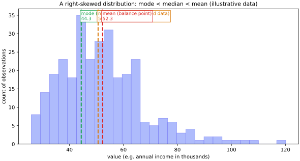

## What you will learn

- Compute the **mean**, the **median** and the **mode** of a dataset by hand.
- Read the three averages' mathematical notation without flinching.
- Prove — by derivation, not by decree — that the mean is the balance point of the data.
- Predict which average an outlier drags, and by how much.
- Verify every hand calculation in Python with NumPy, and see the two agree exactly.
- Choose the defensible average when reporting results, and say why in one sentence.

## Why this topic matters

"An average person spends 5 hours a day on their phone." "The average salary in this industry is 70 thousand." "Typical delivery time is 30 minutes." Every one of these sentences uses an average — and every one could be lying to you, depending on which average was picked and who picked it. The mean, median and mode are the three ways statistics names a "typical" value, they can disagree wildly on the same data, and the gap between them is often the most interesting fact in the dataset. If you can compute all three and explain why they differ, you can read a news report, an executive dashboard or a machine-learning summary and know exactly what is being claimed.

## Prerequisites

None — this is the first lesson of the subject, and it deliberately uses nothing beyond addition, division and sorting. If you can add a column of numbers and put a list in order, you are ready.

## Everyday-life explanation

Imagine five friends comparing the number of books they read last year: 2, 3, 4, 5 and 5. What is a "typical" reading year? You have three instinctive answers, and each is a different average. The share-it-out answer: pour all 19 books into one pile and split it five ways — everyone gets about 3.8. That is the **mean**: the even split. The stand-in-line answer: line the friends up from least to most read and ask the person in the middle — they read 4. That is the **median**: the person in the middle of the sorted line. The most-popular answer: two different friends each read 5, so 5 is the number that shows up most. That is the **mode**: the crowd favorite.

Notice the three answers are different — 3.8, 4 and 5 — on the very same data. None is "wrong"; each answers a subtly different question. And there is a fourth character hiding in this story: if one friend had read 50 books instead of 5, the even-split mean would jump to almost 13, the middle-of-line median would barely budge, and the crowd favorite would not move at all. That troublemaker value is called an **outlier**, and this whole subject is partly about what outliers do to our summaries.

## Conceptual explanation

The three averages each capture a different notion of "center". The **mean** is the balance point: if the values were weights strung along a ruler, the mean is the exact spot where the ruler would balance on a fulcrum. Big values far to the right exert leverage, which is precisely why one huge outlier drags the mean toward itself — leverage grows with distance, so a single extreme value can outweigh many ordinary ones. The **median** is the middle position: sort the values, walk halfway, and report where you stand. Distance does not matter to the median, only rank. You could replace the largest value in a dataset with ten thousand and the median would not move a millimeter, because the largest value is still just "the largest" — rank 1 from the top stays rank 1. The **mode** is the peak of popularity: the value that occurs most often, which is the only average that even exists for non-numeric data like colors or job titles.

Which one is "right"? Wrong question — each answers a specific question. The mean answers "what is the even split?" and is the one used in further calculations (variance, for instance, is built on it). The median answers "what would a typical person experience?" and is the honest choice when a few extreme values would distort the mean. The mode answers "what is most common?" and shines for categories and for multimodal data. Income, house prices and website response times are famously right-skewed — a long tail of large values — so analysts report medians. Exam scores near a target, heights, and measurement errors are roughly symmetric, and there the three averages agree closely.

## Formal definition

For a dataset of `n` values `x₁, x₂, …, xₙ`: the **mean** x̄ is the sum of the values divided by their count, x̄ = (Σ xᵢ) / n. The **median** is the middle value of the sorted data when n is odd; when n is even it is the arithmetic mean of the two middle values. The **mode** is the value with the highest frequency, when such a value exists; otherwise the dataset has no mode.

## Mathematical notation

Each symbol below is a piece of vocabulary you will meet again and again in this subject. The four to learn today are `x̄` (the sample mean), `μ` (the population mean), `xᵢ` (the i-th value) and `Σ` (the summation sign), plus the count `n` that always rides along:

```text
symbol    read aloud               meaning
x̄         "x-bar"                  the sample mean (the bar sits on top of x)
μ         "mew"                    the population mean (when every member is measured)
xᵢ        "x sub i"                the i-th value in the dataset
i = 1..n  "i runs from 1 to n"      which values we are talking about
n         "n"                      how many values there are
Σ         "capital sigma"           "add up everything that follows"
```

So the mean formula x̄ = (Σᵢ₌₁ⁿ xᵢ) / n is read aloud as: "add up all the values from the first to the last, and divide by how many there are." Nothing more mysterious is hiding in it.

## Important terminology

A **mean** is the arithmetic average — the sum divided by the count — and is the balance point of the data. A **median** is the middle of the sorted data, and a **resistant statistic** like the median is one that barely moves when an extreme value changes. The **mode** is the most frequent value. An **outlier** is a value far outside the bulk of the data, notorious for dragging the mean. **Skewness** is the tilt of a distribution: right-skewed data has a long tail of large values, which pushes its mean above its median, while left-skewed data tilts the other way. **Bimodal** data has two peaks, and a single average may describe neither of them honestly.

## Step-by-step explanation

Computing each average is a short, mechanical procedure:

1. **The mean.** Add every value, then divide by how many values there are. For the reading-years data 2, 3, 4, 5, 5: the sum is 19, the count is 5, and the mean is 19 / 5 = 3.8.
2. **The median.** Sort the values into order — 2, 3, 4, 5, 5 — then find the middle position. With 5 values, the middle is the 3rd, so the median is 4. With an even count, take the two middle values and average them.
3. **The mode.** Count how often each value occurs: 5 occurs twice, everything else once. The mode is 5. If no value repeats, say "no mode" — do not invent one.
4. **The check.** Ask which values are extreme, and by how much: the pull of each value on the mean grows with its distance from the crowd. If someone's book count were 50, step 1 would leap upward, step 2 would shift by at most one position, and step 3 would not change at all. Computing an average is easy; knowing which one survives contact with outliers is the actual skill.

## Step-by-step derivations

Formulas you can derive are formulas you cannot forget. Here is why the mean is the balance point.

**Derivation — the deviations from the mean always cancel.** We want to show that the sum of deviations from the mean, Σ (xᵢ − x̄), is exactly zero.

1. Expand the sum: Σ (xᵢ − x̄) = Σ xᵢ − Σ x̄, because the sum of a difference is the difference of the sums.
2. In the second term, x̄ is a constant added n times, so Σ x̄ = n · x̄. (Definition of repeated addition.)
3. Substitute the definition of the mean, x̄ = (Σ xᵢ) / n, which rearranges to Σ xᵢ = n · x̄. (Multiply both sides by n.)
4. Therefore Σ (xᵢ − x̄) = n · x̄ − n · x̄ = 0. The deviations above the mean exactly cancel the deviations below it — which is the balance point, proved rather than asserted.

**Derivation — why the median's position is (n + 1) / 2 for odd n.** Sort the values; positions run from 1 to n. A middle position must have as many values below it as above it, so it needs (n − 1) / 2 values on each side. That puts the middle at 1 + (n − 1) / 2 = (n + 1) / 2. For 5 values: (5 + 1) / 2 = position 3 — exactly where we found it, and the +1 exists because counting starts at 1, not at 0.

## Visual explanation

The figure below shows what right-skewed data does to the three averages — the long right tail drags the mean past the median, while the mode stays with the crowd. This ordering is so reliable that statisticians read it as a diagnostic: **mode < median < mean means right skew**.



And the same story as numbers, for the 28-person salary dataset you will meet again in the worked examples:

```text
                       with the outlier     without the outlier
mean (balance point)      68.4                   62.1
median (middle rank)      57.0                   56.0
one value changed         —                      240 removed
```

One salary out of 28 moved the mean by more than 6, and the median by exactly 1. Distance is leverage for the mean; the median only counts heads.

## Worked examples

### Example 1 — all three averages on five quiz scores

Statement: a learner scores 4, 3, 5, 2 and 5 on five quizzes (each out of 5). Find all three averages. Steps: sum the scores (4 + 3 + 5 + 2 + 5 = 19) and divide by 5 to get the mean, 3.8. Sort the scores — 2, 3, 4, 5, 5 — and take the middle (3rd) value, so the median is 4. The value 5 appears twice while every other appears once, so the mode is 5. Answer: mean 3.8, median 4, mode 5. Check: the mean sits between the extremes, the median is a value that actually occurs, and the mode equals the top score — consistent with a strong student whose two best days repeated.

### Example 2 — even count, and a bimodal surprise

Statement: eight students report weekly study hours of 2, 3, 3, 4, 5, 5, 6, 7. Find all three averages. Steps: the sum is 35, so the mean is 35 / 8 = 4.375. With 8 values (even count), the middle two are the 4th and 5th sorted values, 4 and 5, so the median is (4 + 5) / 2 = 4.5. Counting occurrences: both 3 and 5 appear twice, and nothing appears more often. Answer: mean 4.375, median 4.5, and the dataset is bimodal with modes 3 and 5. Check: with an even count the median need not be an observed value — 4.5 hours is nobody's actual week — and two modes are a real feature of the data, not a tie to break arbitrarily.

### Example 3 — an outlier moves the mean, not the median

Statement: 28 people in a small company earn the salaries listed below (in thousands). One executive earns 240. Find the mean and median with and without the outlier.

```text
30, 32, 34, 36, 38, 40, 42, 44, 46, 48, 50, 52, 54, 56,
58, 60, 62, 64, 66, 70, 74, 78, 82, 90, 100, 120, 150, 240
```

Steps: the sum of all 28 salaries is 1916, so the mean is 1916 / 28 ≈ 68.4. Sorting (already sorted), the middle two values are the 14th and 15th — 56 and 58 — so the median is (56 + 58) / 2 = 57. Removing the 240 outlier: the sum drops to 1676 over 27 values, mean ≈ 62.1, and the median becomes the 14th value alone, 56. Answer: with the outlier, mean ≈ 68.4 and median 57.0; without it, mean ≈ 62.1 and median 56.0. Check: removing a single value moved the mean by over 6 thousand, while the median shifted by 1 — exactly the leverage-versus-rank behavior predicted in the conceptual explanation, and exactly why salary surveys report medians.

## Code demonstration

Every hand calculation above can be verified in three lines of NumPy. First, the quiz scores — the code confirms the mean of 3.8, the median of 4, and finds the mode by counting:

```python
import numpy as np

scores = [4, 3, 5, 2, 5]
print("mean:", np.mean(scores))
print("median:", np.median(scores))
values, counts = np.unique(scores, return_counts=True)
print("mode:", values[np.argmax(counts)])
```

```text
mean: 3.8
median: 4.0
mode: 5
```

And the outlier experiment, exactly as in Example 3:

```python
import numpy as np

salaries = np.array([30, 32, 34, 36, 38, 40, 42, 44, 46, 48,
                     50, 52, 54, 56, 58, 60, 62, 64, 66, 70,
                     74, 78, 82, 90, 100, 120, 150, 240])
without = salaries[salaries < 240]
print("with outlier:   mean", np.mean(salaries), "median", np.median(salaries))
print("without:        mean", np.mean(without), "median", np.median(without))
```

```text
with outlier:   mean 68.42857142857143 median 57.0
without:        mean 62.074074074074076 median 56.0
```

The machine agrees with the hand calculations to the last digit — 68.42857… rounds to the 68.4 we computed, and the median is exactly 57. When your by-hand work and the code disagree, one of them is wrong; this habit of double-checking is the cheapest quality control in data work.

## Common mistakes

1. **Reporting the mean of skewed data as "typical".** The 28-salary example shows a mean of 68.4 while 20 of 28 people earn less than 66 — the mean describes the balance point, not the person. The fix: report the median for skewed quantities like income and response times, or report both and say why they differ.
2. **Forgetting to sort before taking the median.** The middle of 4, 3, 5, 2, 5 is not 5 — it is 4, because the middle must be found in the sorted list 2, 3, 4, 5, 5. The fix: sorting is step one of the median procedure, always.
3. **Averaging averages carelessly.** The mean of class means is not the school mean unless every class is the same size — a class of 10 and a class of 40 cannot be averaged 50/50. The fix: recompute from the raw totals, or weight each class by its size.

## Practical applications

In industry these three numbers are the first thing an analyst computes, and the choice among them is the first decision that can mislead. Salary guides and housing reports lead with the **median** because incomes and prices are right-skewed. Support and delivery teams watch the **mean** response time because it multiplies out into total delay cost, but they track the median too — a gap between the two is an early-warning of tail latencies. Retail uses the **mode** for sizing (the most-sold size is what to restock), and it is the only average available for categorical data like product colors. In machine learning, the mean reappears inside the squared-error loss that most models minimize — a fact you will meet again later in this subject, where the balance-point derivation you just did becomes the reason the loss is minimized at the mean.

## Key takeaways

- The **mean** is the balance point — the sum divided by the count — and it is pulled by outliers in proportion to their distance.
- The **median** is the middle of the sorted data — a resistant statistic that moves by rank, not by distance.
- The **mode** is the most frequent value, the only average that exists for categories — and sometimes there is none.
- For right-skewed data, expect **mode < median < mean**; the ordering itself is a diagnostic.
- Σ (xᵢ − x̄) = 0 is the balance-point proof: deviations above and below the mean cancel exactly.
- Report the average that answers the question being asked, and say which one you used.

## Practice exercises

Work the three exercises in the panel below with pencil first, code second. The first two are straight calculations on small datasets — one with an even count, one with a surprise in the counting. The third is the judgment call this whole lesson exists for: interpreting an average someone else reported. Hints reveal progressively more; the worked solutions show every step, and the final line of each solution is the answer you should be able to state in one sentence.

## Knowledge check

Four quick questions below — no calculator needed for the first three. The distractors are the answers that feel right before the concepts settle, and each one's feedback explains the misconception it encodes. Answer first, read feedback second: a wrong answer you understand is worth more than a guess you got right.

## Further reading

- [OpenIntro Statistics, chapter 2 — descriptive statistics](https://www.openintro.org/book/os/) — a free, rigorous textbook whose treatment of center and spread pairs perfectly with this subject.
- [Khan Academy — mean, median and mode](https://www.khanacademy.org/math/statistics-probability/summarizing-quantitative-data) — extra practice problems with instant feedback, good for building speed.
- [How to Lie with Statistics, by Darrell Huff](https://en.wikipedia.org/wiki/How_to_Lie_with_Statistics) — a classic, joyful tour of the ways averages are used to mislead; read it and become unmisleadable.
