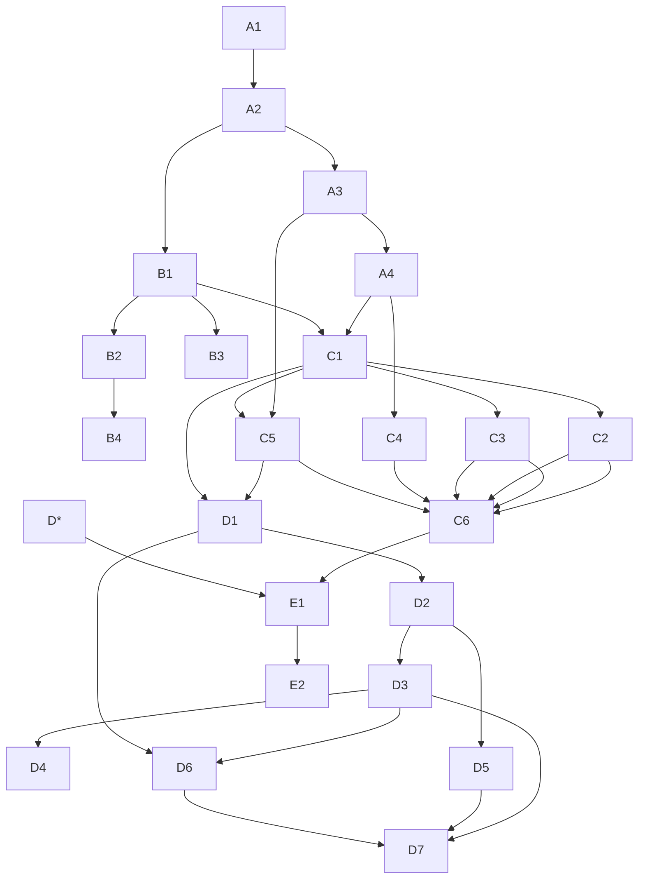

# CURRICULUM_ARCHITECTURE.md

**Project:** Data Science & AI Learning Academy ("DataVerse Academy")
**Phase:** 1 — Product Analysis & Planning
**Version:** 1.0.0-draft
**Date:** 2026-11-13
**Related:** `PRODUCT_REQUIREMENTS.md` (§6 outcomes, FR-02..FR-10), `SYSTEM_ARCHITECTURE.md` (§8 content pipeline), `FEATURE_SPECIFICATION.md`

---

## Table of Contents

1. [Pedagogical Foundation](#1-pedagogical-foundation)
2. [Curriculum Hierarchy](#2-curriculum-hierarchy)
3. [Full Curriculum Map](#3-full-curriculum-map)
4. [Prerequisite Graph & Unlock Logic](#4-prerequisite-graph--unlock-logic)
5. [Lesson Anatomy: The Learning Loop](#5-lesson-anatomy-the-learning-loop)
6. [Term-First Authoring & the Glossary System](#6-term-first-authoring--the-glossary-system)
7. [Math-Without-Fear Design](#7-math-without-fear-design)
8. [Exercise Taxonomy & Scaffolding Ladder](#8-exercise-taxonomy--scaffolding-ladder)
9. [Assessment Architecture](#9-assessment-architecture)
10. [Projects, Capstones & Portfolios](#10-projects-capstones--portfolios)
11. [Content Management & Production Workflow](#11-content-management--production-workflow)
12. [Career Mapping](#12-career-mapping)
13. [v1 (MVP) Curriculum Scope](#13-v1-mvp-curriculum-scope)
14. [Content Effort Estimation](#14-content-effort-estimation)

---

## 1. Pedagogical Foundation

Every structural choice below traces to one of six evidence-based learning principles, translated into product rules:

| Principle | What it means | How the curriculum enforces it |
|---|---|---|
| **Zero prerequisites (constructivism)** | New knowledge attaches to existing knowledge; a missing foundation is the #1 beginner killer | Nothing is used before it is taught; prerequisite DAG is machine-enforced (`SYSTEM_ARCHITECTURE.md §5.4`) |
| **Cognitive load management** | Working memory is tiny; jargon, math notation, and new tools at once overload it | One new concept per lesson section; term-first authoring (§6); visuals before notation |
| **Worked-example effect** | Beginners learn more from studying worked solutions than from open problem-solving | Every concept: full worked example before any exercise; exercises begin scaffolded (§8.2) |
| **Mastery learning** | Moving on with 60% understanding builds a fragile tower; gaps compound | Checkpoint gates at ≥ 80%; placement credit instead of forced repetition (§9.5) |
| **Retrieval practice & spacing** | Pulling knowledge out beats putting it in; forgetting is curvable | Check questions every lesson; spaced review queue (FR-08-03) |
| **Self-efficacy engineering** | Learners quit from *feelings* ("I'm not a math person"), not difficulty | Early wins in ≤ 10 min; error-friendly framing; streak protection; "confusing" flag listened to |

**Reading-level standard:** clear plain English, ~grade 8–10; sentences ≤ 25 words where possible; second person ("you will…"); no idiom; every analogy drawn from everyday life (recipes, commutes, coffee shops).

---

## 2. Curriculum Hierarchy

```
Program
└── Stage (A–E: Foundations → Programming → Data Craft → ML/AI → Career)
    └── Career Track overlay (Analyst / Data Scientist / ML Engineer)  ← tracks *select* courses, courses are shared
        └── Course (e.g., C1 "Tables of Data: pandas Foundations")
            └── Module (e.g., C1.3 "Choosing rows and columns")   ← mastery gate unit
                └── Lesson (e.g., C1.3.2 "Sorting, the honest way")
                    └── Learning Blocks (the 10-part Learning Loop, §5)
                        └── Elements: text, callout, term, visual, widget,
                                      example, exercise, check, media
```

- **Courses are shared, tracks are overlays.** A lesson is authored once; the Data Scientist track simply requires more courses than the Analyst track (§12). This prevents content duplication and drift.
- **Module = mastery unit.** A checkpoint gates module completion (§9.3). Course = sequence of modules + one guided project (Stages B–D).
- **Lesson = one sitting** (12–18 min average: ≤ 8 min reading + ≥ 5 min interaction). Nobody leaves a lesson without doing something.

---

## 3. Full Curriculum Map

Legend: each course lists modules (M) and lessons (L). **★ = in v1 MVP** (see §13). Datasets are small, realistic, and relatable (coffee shop sales, streaming service, city bikes, clinic appointments, online store).

### Stage A — Foundations from Zero (no code, no math prerequisites)

| Course | Title | Modules (L) | What the learner can do at the end |
|---|---|---|---|
| **A1 ★** | Starting from Zero: Computers, Files & Data | 4 M (14 L) | Explain files, folders, file types, what a program is, where data lives; download/open a CSV; comfort with the platform |
| **A2 ★** | Thinking Like a Computer | 4 M (14 L) | Give precise instructions; spot ambiguity; read and draw simple flowcharts; write step-by-step pseudo-code; understand loops/decisions as ideas |
| **A3 ★** | Math Without Fear | 5 M (18 L) | Work comfortably with percentages, rates, averages (mean/median/mode and when each lies), ranges, simple variables, functions-as-machines, reading any chart; estimate before calculating |
| **A4 ★** | Spreadsheets: Your Data Bridge | 4 M (14 L) | Use formulas, sorting, filtering, pivot tables, and chart-building in any spreadsheet tool; do a first tiny analysis end-to-end |

**Stage A total: 17 M, 60 L.** Stage A deliberately teaches *data thinking* before programming — spreadsheet skills are the bridge for career switchers (persona Raj) and the confidence builder for Maya/Lena.

### Stage B — Programming from Zero

| Course | Title | Modules (L) | End capability |
|---|---|---|---|
| **B1 ★** | Python from Absolute Zero | 6 M (24 L) | Variables, strings, numbers, input/output, decisions, loops, lists, dictionaries, functions — writing small real programs in the browser |
| B2 | Python Practice Lab | 3 M (12 L) | Combine constructs into small programs (menu calculators, text games, mini reports); pattern recognition across problems |
| B3 | Errors Are Teachers | 2 M (8 L) | Read a stack trace calmly; classify the 12 most common beginner errors; apply a 4-step debugging method; ask good questions |
| B4 | Python Meets Files | 3 M (12 L) | Read/write text and CSV files; understand JSON as "data in boxes"; loop over real files |

**Stage B total: 14 M, 56 L.** B3 exists as its own course because error-confidence is a *curriculum outcome*, not an accident (P2 fear: "breaking things").

### Stage C — Data Craft

| Course | Title | Modules (L) | End capability |
|---|---|---|---|
| **C1 ★** | Tables of Data: pandas Foundations | 5 M (24 L incl. project) | Load a CSV; select, filter, sort, group, aggregate; answer business questions with a table; build first charts; complete guided project "Your First Analysis" |
| C2 | Cleaning Real, Messy Data | 4 M (16 L) | Handle missing values, duplicates, wrong types, inconsistent labels; document cleaning decisions honestly |
| C3 | Charts That Tell the Truth | 4 M (16 L) | Pick the right chart for a question; avoid misleading charts; annotate and narrate; build a mini dashboard |
| C4 | SQL and Databases from Scratch | 5 M (20 L) | What a database is; SELECT→WHERE→ORDER→GROUP BY→JOINs→subqueries; design a small table structure; "SQL vs pandas" translation |
| C5 | Statistics, Gently | 6 M (24 L) | Distributions, spread, sampling, confidence intuition, p-values without shame, simple A/B test reading, correlation vs causation |
| C6 | Dashboards & Reporting | 3 M (12 L) | Assemble an analysis into a stakeholder report; write an executive summary; build a dashboard view |

**Stage C total: 27 M, 108 L.** Completing Stage C = **Data Analyst track complete**.

### Stage D — Machine Learning & AI

| Course | Title | Modules (L) | End capability |
|---|---|---|---|
| D1 | The Machine Learning Mindset | 3 M (12 L) | What ML is/isn't; features/labels; train/test thinking; when *not* to use ML; frame a business question as an ML question |
| D2 | Supervised Learning, Step by Step | 6 M (24 L) | Linear regression, logistic regression, decision trees, random forests, k-NN — each: intuition → tiny worked dataset by hand → scikit-learn |
| D3 | Is My Model Any Good? | 4 M (16 L) | Accuracy vs precision/recall vs F1 (when each matters); overfitting playground; cross-validation; baselines; leakage spotting |
| D4 | Finding Groups: Unsupervised Learning | 3 M (12 L) | Clustering intuition, k-means by hand, choosing k, use cases and traps |
| D5 | Neural Networks from Intuition | 4 M (16 L) | Neurons as tiny decision-makers; activations; loss as "how wrong"; gradient descent slider; backprop as blame assignment; train a small net in the sandbox |
| D6 | Words and Machines: NLP & LLMs for Beginners | 4 M (16 L) | Text as data; tokenization; embeddings as "meaning coordinates"; prompting well; what LLMs can't do; build a tiny sentiment classifier and a retrieval demo |
| D7 | Putting a Model to Work: AI Engineering Basics | 3 M (12 L) | Wrap a model in a simple API; Docker as "a lunchbox for software"; the serving checklist; monitoring basics |

**Stage D total: 27 M, 108 L.** Stage C + D = **Data Scientist track**. D7 + engineering-flavored capstone distinguishes the **ML Engineer track**.

### Stage E — Career

| Course | Title | Modules (L) | End capability |
|---|---|---|---|
| E1 | Your Portfolio, Your Story | 4 M (16 L) | Track capstone; write project READMEs that read like case studies; publish portfolio page; demo project to a friend |
| E2 | Career Launchpad | 3 M (12 L) | Job profiles & skill self-audit; data-focused resume; interview prep (concepts, SQL, coding, behavioral) with practice bank; first-90-days plan; data ethics at work |

**Stage E total: 7 M, 28 L.**

### Program totals (full vision)

| | Courses | Modules | Lessons | Guided projects | Capstones |
|---|---|---|---|---|---|
| Stage A | 4 | 17 | 60 | 0 (lesson-level projects only) | — |
| Stage B | 4 | 14 | 56 | 1 (end of B1★) | — |
| Stage C | 6 | 27 | 108 | 2 (C1★, C6) | 1 (Analyst) |
| Stage D | 7 | 27 | 108 | 2 (D2, D5) | 2 (Data Scientist, ML Engineer) |
| Stage E | 2 | 7 | 28 | — | (capstone work happens here) |
| **Total** | **23** | **92** | **360** | **5** | **3** |

Supporting assets across the program: **~320 glossary terms** (each with plain-English definition + micro-example), **~1,400 exercises**, **~2,600 check questions** (pooled), **8 interactive widgets** (§8.3), **~60 curated datasets**, **~40 cheat sheets** (one per module, printable).

---

## 4. Prerequisite Graph & Unlock Logic



**Unlock rules (enforced by the Progress engine):**

| Rule | Behavior |
|---|---|
| U-1 Lesson unlock | A lesson unlocks when its prerequisites (module-level) are mastered or placement-credited |
| U-2 Module mastery | Module checkpoint ≥ 80% (unlimited low-stakes retakes, fresh question draws) |
| U-3 Placement credit | Diagnostic mastery in a domain marks covered modules `credited` (shown as "skipped — you proved it", never as failure) |
| U-4 No hard walls sideways | A learner may *read* any published lesson (guest browsing), but exercises/progress require the unlock — freedom to look ahead, structure to keep honest |
| U-5 Review instead of repeat | Failed checkpoint twice → platform prescribes the 2–3 specific lessons (by outcome-level evidence) + tutor check-in, not a full module repeat |

---

## 5. Lesson Anatomy: The Learning Loop

Every lesson is authored as an ordered sequence of typed **learning blocks**. The Content Studio's linter *rejects* lessons that omit required blocks (FR-15-02) — the loop is not a style guide, it is a schema.

| # | Block | Purpose | Required? |
|---|---|---|---|
| 1 | **Why this matters** | 3–5 sentences: a real job scenario where this skill is used; what you'll be able to do in 15 minutes | Always |
| 2 | **Explain (plain English)** | The concept, no jargon, analogy first; ≤ 1 new concept per section | Always |
| 3 | **Terms introduced** | Auto-generated card from the term registry; each term: definition + micro-example (§6) | If new terms |
| 4 | **See it (visual/widget)** | Diagram or interactive widget (e.g., gradient-descent slider); manipulable wherever the concept has a "knob" | If visualizable |
| 5 | **Worked example** | Full solved example, narrated step by step, including one "wrong turn and recovery" where natural | Always |
| 6 | **Guided exercise** | Scaffolded: pre-filled starter, 3-level hint ladder, instant feedback, distractor rationales | Always |
| 7 | **Independent exercise** | Same skill, no hints; counts as mastery evidence | Always |
| 8 | **Check your understanding** | 2–5 pooled questions, immediate feedback, one retrieval on a *previous* lesson (spacing) | Always |
| 9 | **Summary & cheat sheet** | 5–8 bullet recap; link to module cheat sheet | Always |
| 10 | **What's next** | 2–3 sentences bridging to the next lesson + optional "go deeper" collapsible | Always |

**Worked example anatomy** (linted): setup in words → the question → step-by-step with *why* at each step → result → sanity check ("is this plausible?"). Estimation-before-calculation is required in all quantitative examples (A3 onward).

---

## 6. Term-First Authoring & the Glossary System

The platform's signature promise: **every unfamiliar term is defined at first use, in simple English.**

### 6.1 Term registry

- Single source of truth (`content/term-registry.yaml` → `glossary_terms` table): term, plain-English definition (≤ 40 words), micro-example, related terms, first-introducing lesson.
- First use in any lesson renders as a **dotted underline**; hover/tap → tooltip (definition + example + "hear it from Ada"). Term card also appears in block 3.
- Glossary hub (FR-03-02) lists all terms with search, filter by stage/course, and personal "terms I've met" tracking.

### 6.2 Authoring rules (CI-enforced, FR-03-04)

| Rule | Enforcement |
|---|---|
| T-1 No term is used before it is defined (in this lesson or an earlier lesson/its term list) | Linter resolves every registered term's first-use position |
| T-2 A lesson may introduce ≤ 5 new terms | Linter count check |
| T-3 Definitions avoid other unexplained jargon ("circular definition" check: definition may only use terms introduced earlier or common words) | Linter vocabulary graph |
| T-4 Tutor replies auto-link registry terms | Tutor post-processor (SYSTEM §7.3) |
| T-5 Re-introduce gently: a term unused for 10+ lessons gets a one-line reminder on reappearance | Content build rule |

**Example** — the registry entry for `mean`:

> **mean** *(noun)* — the "evening out" value you'd get if you shared everything equally. Add all values, divide by how many there are. *Example:* 4 friends' lunch bills are 8, 9, 10, 13 → mean 10 — the fair-share bill.

---

## 7. Math-Without-Fear Design

A3 "Math Without Fear" is the make-or-break course for personas Maya and Lena. Design rules applied *program-wide* to any mathematical content:

1. **Intuition → Visual → Numbers → Formula → Deconstruction.** The mean is "fair sharing" (intuition), a balance beam (visual), worked with real lunch bills (numbers), Σx/n (formula) — then the formula is deconstructed symbol by symbol ("Σ just means 'add them all up'").
2. **Formulas are never the entrance.** They appear only after the process they compress has been performed manually at least twice.
3. **Estimate first.** Every quantitative lesson opens with "guess before you calculate" — builds number sense and protects against absurd answers.
4. **Math anxiety is addressed explicitly, once, kindly.** A3 opens with "Math class may have hurt. This is not math class." — one honest paragraph, then competence-building.
5. **Every math concept arrives with a job title attached.** "Percent change is the analyst's bread and butter — you'll use it weekly."
6. **No notation without a pronunciation guide.** Σ is "sigma", and it says "add them all up."
7. **Formula safety net:** any formula shown can be tapped → symbol-by-symbol popup (KaTeX + annotation layer).

---

## 8. Exercise Taxonomy & Scaffolding Ladder

### 8.1 Exercise types (v1)

| Type | Machine-gradable | Used for | Notes |
|---|---|---|---|
| Multiple choice / multi-select | Yes | Concept checks, "spot the lie" | Authored distractors with rationales (why this tempting answer is wrong) |
| Fill-in-the-blank | Yes (exact/numeric tolerance) | Formulas, code keywords | |
| Ordering / sequencing | Yes | Algorithms steps, analysis order, SQL clause order | |
| Matching | Yes | Term ↔ definition, chart ↔ question | |
| Data interpretation | Yes | "Read this table/chart, answer" | Static or generated datasets |
| Parsons problem | Yes (order + indentation) | Code construction before free typing | Beginner-safe: reduces typing burden |
| Code-with-feedback | Yes (test cases) | Real code, Pyodide or sandbox | Test output → error coach |
| Free response (short) | AI-assisted rubric, sampled | "Explain to a stakeholder" | Used sparingly; builds communication skill |

### 8.2 Scaffolding ladder (within every exercise set)

```
Level 0  Worked example (studied, not solved)
Level 1  Completion exercise — most of the solution is present, learner fills key steps
Level 2  Scaffolded exercise — structure + hint ladder (nudge → strategy → worked step)
Level 3  Independent exercise — problem statement + starter code only
Level 4  Transfer exercise — same skill, new context (guided projects/capstones)
```

Hints **never reveal the answer**; hint level 3 shows one fully worked *parallel* example, not the solution. Tutor Ada can elaborate the current hint level only (SYSTEM §7.4).

### 8.3 Interactive widgets (v1 set of 8)

| Widget | Concept | Interaction |
|---|---|---|
| Fair-share beam | Mean vs median vs skew | Drag values; see balance point vs middle value |
| Distribution builder | Histograms, bins, spread | Drag data points; watch shape change |
| Sampling machine | Sampling variability, CLT intuition | Draw samples of size n repeatedly; watch sample means pile up |
| Train/test splitter | Why we hold out data | Drag the split slider; see train vs test error diverge |
| Overfitting playground | Model complexity | Tune flexibility; see the two curves cross |
| Gradient descent slider | How learning "descends" | Set learning rate; watch steps converge, bounce, or explode |
| JOIN visualizer | SQL joins | Two tables of orders/customers; toggle join types; see rows light up |
| Meaning map | Embeddings intuition | Explore a 2-D projection of related words; see "king − man + woman" |

Widgets are React components in `packages/ui` with declared state presets (shareable URLs, FR-04-03) and keyboard-accessible controls (NFR-10).

---

## 9. Assessment Architecture

### 9.1 Assessment philosophy

- **Open-book by design.** Learners will use references on the job; we test *application*, not recall trivia. Questions are written to be answer-resistant-to-lookup (interpret, predict, choose, debug).
- **Formative is unlimited; summative is bounded.** Retakes of module checkpoints are free and low-stakes (fresh draws). Course exams have modest limits (1 attempt per 24 h) to make certificates *mean* something.
- **Assessment is data, not judgment.** Every attempt feeds the mastery engine and the learner's own "what to review" queue.

### 9.2 Assessment levels

| Level | Instrument | Size | Gate | Frequency |
|---|---|---|---|---|
| L1 Formative | Check questions (in-lesson) | 2–5 | None (mastery evidence) | Every lesson |
| L2 Formative | Exercise sets | 2–4 exercises | Hint usage tracked | Every lesson |
| L3 Module gate | Checkpoint | 8–15 items, ~15 min | ≥ 80% mastery | Every module |
| L4 Course | Course exam | 20–30 items + 1 practical task, 45–60 min, timed | ≥ 75% → certificate | Every course |
| L5 Track | Track final + capstone | Practical, rubric-scored | Rubric ≥ 3/4 average, no criterion < 2 | Track end |
| L6 Continuous | Spaced review queue | 5–10 items/day | None | Daily, SM-2-lite |

### 9.3 Checkpoint design

- Items drawn adaptively from outcome-tagged pools: first by weak outcomes (from lesson evidence), then broad coverage; difficulty ramps within the attempt.
- Item pools per module: ≥ 3 variants per assessed outcome, so retakes are fresh but fair.
- Result screen is a **learning artifact**: per-outcome breakdown, "review these 2 lessons" prescriptions, one-click "practice the weak outcome" set.

### 9.4 Item-writing rules (linted in Content Studio)

| Rule | Detail |
|---|---|
| I-1 | Every item maps to exactly one lesson outcome (no orphan outcomes, no untested outcomes) |
| I-2 | Every distractor has an authored rationale ("why someone picks this, and why it's wrong") |
| I-3 | No trick questions, no "all of the above", no negation without bolding |
| I-4 | Plausible, data-flavored contexts (coffee shop, bikes, clinic) — never abstract "x and y" |
| I-5 | Numerical items accept tolerance and sensible rounding; require units where the job would |
| I-6 | One item, one idea (no compound questions) |

### 9.5 Placement & mastery model

- Placement diagnostic (FR-01-03): 5 adaptive sections (logic, math, spreadsheets, Python, SQL), 15–25 min, skippable anytime; awarding module credit requires **strong evidence** (≥ 90% on a section's credit set) — false skips are the bigger risk for beginners.
- Mastery evidence weighting (per outcome): independent exercise 0.35, checkpoint items 0.35, lesson checks 0.20, review-queue retention 0.10. States: **strong** (≥ 0.8), **developing** (0.5–0.8), **needs review** (< 0.5 → enters review queue).

### 9.6 Integrity stance (v1)

No proctoring, no webcam, no shaming. Course-exam question pools + practical tasks make pure answer-sharing low-value; certificates state "open-book, project-based" honestly. Revisit in v2 if certificate abuse appears.

---

## 10. Projects, Capstones & Portfolios

### 10.1 Guided projects (auto-checked, scaffolded)

| # | Project | After course | Scenario |
|---|---|---|---|
| P1 | Your First Analysis | C1 | Coffee-shop sales: load, clean-lite, 5 business questions, 3 charts, one-paragraph takeaway |
| P2 | The Messy Reality | C2 | Streaming-service dataset with real defects; cleaning decision log required |
| P3 | The Stakeholder Report | C6 | Clinic appointments → exec summary + dashboard |
| P4 | First Predictions | D2 | Online-store dataset → churn prediction with honest baseline comparison |
| P5 | Teach a Tiny Brain | D5 | Handwritten-digit classifier in sandbox + written intuition diary |
| P6 | Model Behind a Menu | D7 | Wrap P4's model in a small API + 1-page serving checklist |

### 10.2 Track capstones (rubric-scored, portfolio-grade)

| Track | Capstone | Deliverables |
|---|---|---|
| Analyst | "City Insights Brief" — city-bike + demographics data → a decision brief for a fictional council | Notebook + dashboard + 1-page brief + 5-min walkthrough writeup |
| Data Scientist | "Experiment & Model" — A/B test reading + churn model with error analysis | Analysis notebook + model card + stakeholder deck outline |
| ML Engineer | "Model to Endpoint" — train, evaluate, wrap, containerize, document | Repo (README as case study) + working API demo + deploy checklist |

### 10.3 Rubric (4 criteria × 4 levels, published to learners upfront)

| Criterion | 1 = Emerging | 4 = Excellent |
|---|---|---|
| Technical correctness | Code runs with help | Runs clean, sensible methods, reproducible |
| Analytical honesty | Conclusions overreach | Limitations and uncertainty stated plainly |
| Communication | Wall of numbers | Stakeholder-ready narrative, honest visuals |
| Process | Result-only | Documented iterations, including a wrong turn and its fix |

Scoring: rubric self-assessment → automated checks (code quality gates, reproducibility) → sampled AI-assisted rubric feedback (Phase 5+) → pass ≥ 3.0 average, no criterion < 2, one free resubmission.

### 10.4 Portfolio

Public shareable page per learner (FR-10-03): hero (name, track, certificate badges), projects with abstracts/tags/artifact links, "verified skills" chips pulled from the mastery model. Exportable as PDF résumé annex.

---

## 11. Content Management & Production Workflow

(Technical pipeline: `SYSTEM_ARCHITECTURE.md §8`. This section governs people and process.)

### 11.1 Content-as-code layout

```
content/
├── term-registry.yaml          # the vocabulary spine (§6)
├── stages/A..E/
│   └── courses/C1/
│       ├── course.yaml          # outcomes, prerequisites, datasets, widgets used
│       ├── datasets/            # CSV/JSON + dataset.yaml (source, license, columns)
│       └── modules/C1.3/
│           ├── module.yaml      # outcomes → item pool refs, checkpoint blueprint
│           └── lessons/C1.3.2-sorting/
│               ├── lesson.yaml  # outcomes, terms introduced, blocks order
│               └── blocks/*.mdx # typed learning blocks (schema-validated)
└── pools/                       # item pools (questions, distractors, rationales)
```

### 11.2 Workflow & roles

```
Author drafts (git branch) → CI lint (schema · terms · reading level · loop completeness)
→ Preview deploy → Pedagogical review (checklist) → Technical review (code/tests run)
→ Approve & merge → Import (versioned) → Publish (atomic course version → ISR + RAG re-index)
```

- **Author** writes; **Pedagogical reviewer** checks principles §1, terms, tone, item rules; **Technical reviewer** runs all code/tests, verifies datasets and licenses.
- Every publish is an immutable version; rollback = republish prior version; learner progress is version-aware (SYSTEM §8).
- Two-week content freeze windows accompany each phase launch (roadmap doc §3).

### 11.3 Style guide essentials (enforced by linter + review)

Reading level ~grade 8–10; sentences ≤ 25 words; second person, active voice; one new concept per section; analogies from a shared "analogy bank" (consistent metaphors program-wide — data is always "ingredients", a function is always "a machine with inputs and outputs"); no unexplained notation; humor allowed, sarcasm not; encouragement specific ("you just wrote your first loop"), never generic ("great job!").

### 11.4 Dataset standards

Realistic-but-synthetic or openly licensed real data; every dataset ≤ 5 MB (fast loads), ships with a `dataset.yaml` (source, license, column dictionary in plain English, 3 sample questions it can answer); diversity of contexts across the program (business, health, civic, sports); no PII ever.

---

## 12. Career Mapping

| Track | Course path (in order) | Outcome portfolio | "Job-ready when…" (FR-11-04) |
|---|---|---|---|
| **Data Analyst** | A1–A4 → B1 → C1–C6 → E1–E2 | P1, P2, P3, Analyst capstone | SQL + pandas + viz checkpoints mastered; capstone ≥ 3.0; can walk through P3 unaided |
| **Data Scientist** | Analyst path (minus C6 optional) → D1–D6 → E1–E2 | P1, P2, P4, P5, DS capstone | + C5 & D3 mastered (stats + evaluation); capstone ≥ 3.0 |
| **ML Engineer** | A1–A4 → B1–B4 → C1, C4, C5 → D1–D7 → E1–E2 | P4, P6, MLE capstone | + B4, D7 mastered; capstone API runs from repo README steps |

Each course page shows the job skills it feeds ("This course gives you: 3 of 12 core analyst skills"). The Career Center (FR-11) renders this mapping with role profiles, salary context (with sources), and a skill self-audit against the learner's live mastery data.

---

## 13. v1 (MVP) Curriculum Scope

**MVP promise:** *an absolute beginner reaches their first real, portfolio-worthy analysis with nothing but a browser.*

| Included | Detail |
|---|---|
| Courses | **A1, A2, A3, A4, B1, C1** (6 courses, 31 modules) |
| Lessons | **108** (all full Learning Loop, all lint-clean) |
| Terms | First **~130** registry entries |
| Exercises & checks | ~430 exercises, ~780 pooled check items |
| Widgets | 2 (fair-share beam, distribution builder) |
| Datasets | 12 |
| Projects | Guided project **P1 "Your First Analysis"** (portfolio-publishable) |
| Placement | Sections: logic, math, spreadsheets (Python/SQL sections arrive with their courses) |
| Track status | Data Analyst track: first ~40% live; other tracks: catalog preview only |

**Deferred to v1.x:** C2–C6 (analyst completion), B2–B4, widgets 3–8, remaining placement sections, capstone machinery. **Deferred to v2:** Stage D/E authoring, Data Scientist & ML Engineer tracks, free-response grading. Content sequencing detail per phase: `IMPLEMENTATION_ROADMAP.md §3`.

---

## 14. Content Effort Estimation

Per-lesson effort (authoring → publish-ready), assuming an experienced author + the linter catching mechanical issues:

| Activity | Hours/lesson |
|---|---|
| Outcome design + outline | 0.5 |
| Drafting blocks 1–5 (why/explain/terms/visual/example) | 2.0 |
| Exercises (guided + independent) with distractor rationales | 1.5 |
| Check items (3 avg + pool variants ×2) | 1.0 |
| Datasets/widget wiring (amortized) | 0.5 |
| Reviews (pedagogical + technical) + fixes | 1.0 |
| **Total** | **≈ 6.5 h/lesson** |

| Scope | Lessons | Author-hours | Calendar (1 author @ 50% capacity) |
|---|---|---|---|
| MVP (108 lessons) | 108 | ~700 h | **~7 months** — hence the roadmap pairs content with platform phases: authoring starts in Phase 1 (Wave 1, wk 3), author #2 joins wk 10, and full drafting completes ~wk 19–20 (see `IMPLEMENTATION_ROADMAP.md §2–3`) |
| Analyst track remainder (+52) | 52 | ~340 h | +3.5 months (parallel to platform Phase 5) |
| Data Scientist & MLE tracks (+200) | 200 | ~1,300 h | Post-v1, 2 authors → ~8 months |

**Implication (feeds risk register R1):** content, not code, is the schedule's critical path. The plan front-loads content tooling (lint, preview, term registry) in Phase 1 so authoring quality scales instead of consuming review time.

---

*Assessment item pools, mastery weights, and unlock rules defined here are implemented by the engines in `SYSTEM_ARCHITECTURE.md §5.4` and stored per `DATABASE_DESIGN.md §4–5`.*
