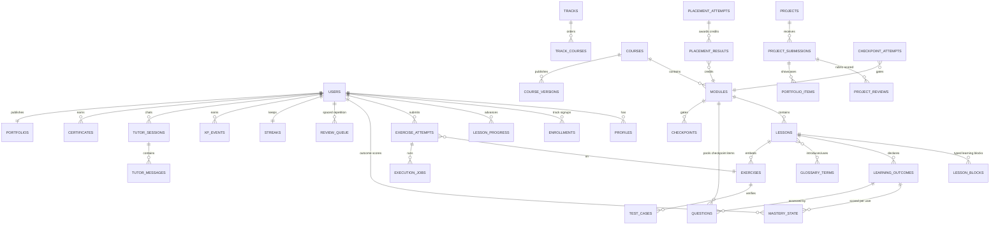

# DATABASE_DESIGN.md

**Project:** Data Science & AI Learning Academy ("DataVerse Academy")
**Phase:** 1 — Product Analysis & Planning
**Version:** 1.0.0-draft
**Date:** 2026-11-13
**Related:** `SYSTEM_ARCHITECTURE.md` (§3 integration contract, §5.4 engines), `CURRICULUM_ARCHITECTURE.md` (entities), `FEATURE_SPECIFICATION.md`

---

## Table of Contents

1. [Overview & Conventions](#1-overview--conventions)
2. [Entity-Relationship Overview](#2-entity-relationship-overview)
3. [Table Catalog by Domain](#3-table-catalog-by-domain)
4. [Prisma Schema (draft)](#4-prisma-schema-draft)
5. [Indexing & Performance Plan](#5-indexing--performance-plan)
6. [Partitioning & Growth Management](#6-partitioning--growth-management)
7. [Data Retention, Privacy & GDPR](#7-data-retention-privacy--gdpr)
8. [Migration Strategy](#8-migration-strategy)

---

## 1. Overview & Conventions

- **Engine:** PostgreSQL 16 with extensions `pgvector` (tutor RAG embeddings) and `pg_trgm` (typo-tolerant search seed).
- **ORM:** Prisma 6, `multiSchema` preview feature — **all Academy tables live in an isolated Postgres schema `academy`** (integration rule IC-3 in `SYSTEM_ARCHITECTURE.md §3`): no foreign keys cross into host schemas even when mounted inside CodeVerse Academy. The only external reference is the opaque `user_id` string.
- **ID strategy:** ` cuid` primary keys for entities created by humans/APIs (order-safe across instances); `bigserial` for high-volume event/log tables.
- **Timestamps:** `created_at`, `updated_at timestamptz` on all mutable tables (`@@map` snake_case).
- **Enums:** database-level enums for closed vocabularies (status, types) — invalid states must be unrepresentable.
- **Soft deletes:** only where learners expect reversibility (account, portfolio items, notes). Hard deletes with retention windows elsewhere (§7).
- **Money/cost:** micro-units in `bigint` (`cost_micros`) to avoid floats.
- **JSON payloads:** only where structure is content-owned and validated by zod at the boundary (lesson blocks, exercise prompts, test expectations); never for queryable relational data.
- **Naming:** tables `snake_case` plural (mapped from PascalCase Prisma models), columns `snake_case`.

---

## 2. Entity-Relationship Overview

Core entities (readable subset; full catalog in §3):



---

## 3. Table Catalog by Domain

### 3.1 Identity & access (schema `academy`)

| Table | Purpose | Key columns (beyond id/timestamps) |
|---|---|---|
| `users` | Learner/operator identity (standalone mode; in mounted mode mirrors host user id as opaque string) | email (unique), email_verified_at, name, role (`learner`/`author`/`admin`), host_user_id nullable, deleted_at |
| `auth_accounts`, `auth_sessions`, `auth_verification_tokens` | Auth.js v5 adapter tables | standard (provider, provider_account_id; session token; token+identifier+expires) |
| `profiles` | Learning preferences & goal | user_id (unique FK), goal_track_id, weekly_minutes, reading_prefs jsonb (fontScale, reducedMotion, theme), locale, placement_completed_at |
| `feature_flags` | Runtime flags (module toggles, IC-7) | key (unique), enabled, rollout_json, updated_by |

### 3.2 Curriculum & content (content-as-code → versioned rows)

| Table | Purpose | Key columns |
|---|---|---|
| `tracks` | Career tracks (Analyst / Data Scientist / ML Engineer) | slug, title, summary, is_published |
| `courses` | 23 courses (CURR §3) | slug, stage (A–E), title, summary, job_skills text[], is_published |
| `track_courses` | Ordered course list per track (shared courses, overlay model) | track_id, course_id, position, required |
| `modules` | Mastery-gate units | course_id, slug, title, position, checkpoint_config jsonb |
| `lessons` | One-sitting lesson | module_id, slug, title, position, minutes_avg, reading_level, is_published |
| `lesson_blocks` | Ordered typed Learning Loop blocks (CURR §5) | lesson_id, position, block_type (enum), payload jsonb (zod-validated per type) |
| `learning_outcomes` | 1–3 measurable outcomes per lesson (drives items + mastery) | lesson_id, code, text, position |
| `glossary_terms` | Term registry spine (CURR §6) | slug, term, definition, micro_example, related_slugs text[], pronunciation |
| `lesson_terms` | Term usage per lesson + `introduces` flag (first-use tooltips, lint input) | lesson_id, term_id, introduces |
| `datasets` | Curated lesson/project datasets + column dictionary | slug, title, source_url, license, size_bytes, storage_key, columns jsonb |
| `widgets` | Interactive widget registry + shareable presets | slug, kind, default_state jsonb |
| `course_versions` | Immutable publish events (atomic version per course) | course_id, version int, changelog, published_at, published_by |
| `content_revisions` | Per-lesson immutable snapshot at publish (rollback + progress pinning) | lesson_id, course_version_id, snapshot jsonb |

### 3.3 Placement & progress

| Table | Purpose | Key columns |
|---|---|---|
| `placement_attempts` | Diagnostic run (adaptive, 15–25 min, skippable) | user_id, started_at, finished_at, sections jsonb |
| `placement_results` | Section scores + credits awarded | attempt_id, section (enum), score, credit_awarded |
| `module_credits` | Placement-credited modules per user (unlock rule U-3) | user_id, module_id, placement_result_id, credited_at |
| `enrollments` | Track signups | user_id, track_id, status, enrolled_at, completed_at |
| `lesson_progress` | Per-lesson state; pins `course_version_id` (never stranded mid-edit) | user_id, lesson_id, course_version_id, status (locked/available/in_progress/completed/mastered), started_at, completed_at, seconds_spent |
| `mastery_state` | Evidence-weighted outcome score (CURR §9.5) | user_id, learning_outcome_id, score numeric, state (strong/developing/needs_review), updated_at |
| `checkpoint_attempts` | Module gate attempts (≥ 80% pass, fresh draws) | user_id, module_id, score, passed, item_results jsonb, outcome_breakdown jsonb, started_at, finished_at |
| `course_exam_attempts` | Timed course exams | user_id, course_id, score, passed, finished_at |
| `review_queue` | Spaced repetition (SM-2-lite) | user_id, item_type (term/question/exercise), item_id, due_at, interval_days, ease_factor, lapses |

### 3.4 Exercises, execution & grading

| Table | Purpose | Key columns |
|---|---|---|
| `exercises` | Embedded exercises (8 types, CURR §8.1) + hint ladder | lesson_id, block_id nullable, kind (enum), runtime (pyodide/sandbox/none), prompt jsonb, starter_code, solution, hints jsonb, position, scaffold_level 0–4 |
| `test_cases` | Code exercise verification | exercise_id, name, input/expected jsonb, hidden bool, weight |
| `exercise_attempts` | Every attempt (mastery evidence + review input) | user_id, exercise_id, is_guided, submitted jsonb/text, passed, hints_used, tutor_used, duration_s, feedback jsonb |
| `execution_jobs` | Sandbox jobs (queue + observability + cost) | id bigserial, user_id, exercise_attempt_id nullable, project_submission_id nullable, status (queued/running/succeeded/failed/timeout/killed), queued_at/started_at/finished_at, cpu_ms, mem_mb_peak, wall_ms, result jsonb, artifact_keys text[], error_class |
| `error_coach_rules` | Curated error mapping (deterministic-first, SYSTEM §6.3) | pattern, course_scope, plain_english, fix_steps jsonb, hits_count |

### 3.5 Projects, rubrics & portfolio

| Table | Purpose | Key columns |
|---|---|---|
| `projects` | Guided projects & capstones (CURR §10) | slug, kind (guided/capstone), track_id nullable, course_id nullable, scenario, brief_url |
| `project_steps` | Auto-checked guided steps | project_id, position, instruction, check_config jsonb |
| `rubrics` | 4×4 published rubrics | project_id, criteria jsonb, pass_rule jsonb |
| `project_submissions` | Learner submissions (snapshotted) | user_id, project_id, status (in_progress/submitted/needs_changes/passed), repo_snapshot_key, notebook_key, artifact_keys text[], self_scores jsonb, submitted_at |
| `project_reviews` | Self / AI / (v2) human reviews | submission_id, reviewer_type, scores jsonb, feedback text, created_at |
| `portfolios` | Public portfolio page | user_id (unique), slug (unique), headline, bio, is_public |
| `portfolio_items` | Showcased submissions | portfolio_id, project_submission_id, abstract, tags text[], position |

### 3.6 AI tutoring

| Table | Purpose | Key columns |
|---|---|---|
| `tutor_sessions` | One chat thread (usually lesson-scoped) | user_id, lesson_id nullable, exercise_id nullable, status, opened_at |
| `tutor_messages` | Transcript rows (cost + quality + flag review) | session_id, role (user/tutor/system), content, tokens_in, tokens_out, model, latency_ms, cost_micros, flagged bool |
| `ai_usage_daily` | Per-user daily rollup (quota enforcement FR-09-07) | user_id, day date, messages, tokens_in, tokens_out, cost_micros, quota_state |
| `rag_chunks` | Curriculum chunks embedded at publish (grounding) | id bigserial, source_type (lesson/term/exercise/rubric), source_id, content, embedding vector(1536), course_version_id |
| `tutor_eval_runs` | Red-team/golden-set regression results (CI-reported) | suite, passed, failed, details jsonb, commit_sha, ran_at |

### 3.7 Gamification & career

| Table | Purpose | Key columns |
|---|---|---|
| `xp_events` | XP ledger (source-typed, idempotent) | user_id, amount, source (exercise/checkpoint/project/review), source_ref, idempotency_key unique |
| `streaks` | One row per learner | user_id (unique), current, longest, last_active_date, freezes_left |
| `badges` / `user_badges` | Meaningful-firsts achievements | slug, title, icon, description / user_id, badge_id, earned_at |
| `job_profiles` | Career Center roles | slug, title, day_in_life, salary_ranges jsonb (sourced), skills text[] |
| `job_profile_courses` | Role skill → course coverage mapping (FR-11) | job_profile_id, course_id, skill, coverage |
| `interview_questions` | Practice bank with walkthroughs | track_id, kind (concept/sql/coding/behavioral), question, walkthrough jsonb, difficulty |
| `certificates` | Issued certificates (PDF + verify URL) | user_id, type (course/track), ref_id, verify_slug unique, issued_at, pdf_key |
| `notes` / `bookmarks` | Learner annotations | user_id, lesson_id, block_position, body / user_id, lesson_id |

### 3.8 Analytics

| Table | Purpose | Key columns |
|---|---|---|
| `analytics_events` | First-party product events (consent-gated; PARTITIONED monthly) | id bigserial, ts, user_id nullable, anonymous_id, name, props jsonb |

---

## 4. Prisma Schema (draft)

Authoritative entity draft; field-level tweaks expected at implementation kickoff. Snake-case mapping and `schema("academy")` omitted below for readability (applied via `@@schema` on every model).

```prisma
// prisma/schema.prisma — Academy module (isolated schema "academy")
generator client { provider = "prisma-client-js" }
datasource db {
  provider   = "postgresql"
  url        = env("DATABASE_URL")
  schemas    = ["academy"]
}

// ---------- Identity ----------
enum Role { LEARNER AUTHOR ADMIN }

model User {
  id               String    @id @default(cuid())
  email            String    @unique
  emailVerifiedAt  DateTime?
  name             String
  role             Role      @default(LEARNER)
  hostUserId       String?   // mounted-mode opaque host identity (IC-4)
  deletedAt        DateTime?
  createdAt        DateTime  @default(now())
  updatedAt        DateTime  @updatedAt
  profile          Profile?
  enrollments      Enrollment[]
  lessonProgress   LessonProgress[]
  exerciseAttempts ExerciseAttempt[]
  // ...relations to progress/gamification/tutoring per §3
}

model Profile {
  id                 String   @id @default(cuid())
  userId             String   @unique
  goalTrackId        String?
  weeklyMinutes      Int      @default(120)
  readingPrefs       Json     @default("{}")   // fontScale, theme, reducedMotion
  locale             String   @default("en")
  placementCompletedAt DateTime?
  user               User     @relation(fields: [userId], references: [id])
}

// ---------- Curriculum ----------
enum Stage { A B C D E }
enum BlockType { WHY EXPLAIN TERMS VISUAL EXAMPLE EXERCISE CHECK SUMMARY NEXT CALLOUT CODE MEDIA DATASET WIDGET }
enum CourseLevel { EASY CORE STRETCH }

model Track {
  id          String @id @default(cuid())
  slug        String @unique
  title       String
  summary     String
  isPublished Boolean @default(false)
  courses     TrackCourse[]
  enrollments Enrollment[]
}

model Course {
  id          String   @id @default(cuid())
  slug        String   @unique
  stage       Stage
  title       String
  summary     String
  jobSkills   String[]
  isPublished Boolean  @default(false)
  modules     Module[]
  versions    CourseVersion[]
}

model TrackCourse {
  id       String  @id @default(cuid())
  trackId  String
  courseId String
  position Int
  required Boolean @default(true)
  track    Track   @relation(fields: [trackId], references: [id])
  course   Course  @relation(fields: [courseId], references: [id])
  @@unique([trackId, courseId])
}

model Module {
  id                String   @id @default(cuid())
  courseId          String
  slug              String
  title             String
  position          Int
  checkpointConfig  Json     @default("{}")   // size, gate score, blueprint refs
  course            Course   @relation(fields: [courseId], references: [id])
  lessons           Lesson[]
  questions         Question[]
  @@unique([courseId, slug])
}

model Lesson {
  id           String    @id @default(cuid())
  moduleId     String
  slug         String
  title        String
  position     Int
  minutesAvg   Int       @default(15)
  readingLevel Int       @default(9)          // linted (CURR §1)
  isPublished  Boolean   @default(false)
  module       Module    @relation(fields: [moduleId], references: [id])
  blocks       LessonBlock[]
  outcomes     LearningOutcome[]
  terms        LessonTerm[]
  exercises    Exercise[]
  progress     LessonProgress[]
  @@unique([moduleId, slug])
}

model LessonBlock {
  id        String    @id @default(cuid())
  lessonId  String
  position  Int
  blockType BlockType
  payload   Json                         // zod-validated per block type
  lesson    Lesson    @relation(fields: [lessonId], references: [id])
  @@unique([lessonId, position])
}

model LearningOutcome {
  id       String   @id @default(cuid())
  lessonId String
  code     String   // e.g. "C1.3.2-1"
  text     String
  position Int
  lesson   Lesson   @relation(fields: [lessonId], references: [id])
  mastery  MasteryState[]
  questions Question[]
  @@unique([lessonId, code])
}

model GlossaryTerm {
  id            String   @id @default(cuid())
  slug          String   @unique
  term          String
  definition    String   @db.Text
  microExample  String   @db.Text
  pronunciation String?
  relatedSlugs  String[]
  lessons       LessonTerm[]
}

model LessonTerm {
  lessonId  String
  termId    String
  introduces Boolean @default(false)   // tooltip on first use
  lesson    Lesson      @relation(fields: [lessonId], references: [id])
  term      GlossaryTerm @relation(fields: [termId], references: [id])
  @@id([lessonId, termId])
}

model Dataset {
  id         String @id @default(cuid())
  slug       String @unique
  title      String
  sourceUrl  String?
  license    String
  sizeBytes  Int
  storageKey String
  columns    Json                  // column dictionary, plain English
}

model Widget {
  id           String @id @default(cuid())
  slug         String @unique
  kind         String
  defaultState Json
}

model CourseVersion {
  id          String   @id @default(cuid())
  courseId    String
  version     Int
  changelog   String?
  publishedAt DateTime @default(now())
  publishedBy String
  course      Course   @relation(fields: [courseId], references: [id])
  revisions   ContentRevision[]
  @@unique([courseId, version])
}

model ContentRevision {
  id              String       @id @default(cuid())
  lessonId        String
  courseVersionId String
  snapshot        Json         // immutable full lesson (rollback + pinning)
  lesson          Lesson       @relation(fields: [lessonId], references: [id])
  courseVersion   CourseVersion @relation(fields: [courseVersionId], references: [id])
  @@unique([lessonId, courseVersionId])
}

// ---------- Placement & progress ----------
enum PlacementSection { LOGIC MATH SPREADSHEETS PYTHON SQL }
enum LessonStatus { LOCKED AVAILABLE IN_PROGRESS COMPLETED MASTERED }
enum MasteryStateEnum { STRONG DEVELOPING NEEDS_REVIEW }

model PlacementAttempt {
  id         String    @id @default(cuid())
  userId     String
  startedAt  DateTime  @default(now())
  finishedAt DateTime?
  sections   Json      @default("[]")
  results    PlacementResult[]
}

model PlacementResult {
  id             String          @id @default(cuid())
  attemptId      String
  section        PlacementSection
  score          Float
  creditAwarded  Boolean         @default(false)
  attempt        PlacementAttempt @relation(fields: [attemptId], references: [id])
}

model ModuleCredit {
  id                String           @id @default(cuid())
  userId            String
  moduleId          String
  placementResultId String?
  creditedAt        DateTime         @default(now())
  @@unique([userId, moduleId])
}

model Enrollment {
  id          String    @id @default(cuid())
  userId      String
  trackId     String
  status      String    @default("active")   // active | paused | completed
  enrolledAt  DateTime  @default(now())
  completedAt DateTime?
  track       Track     @relation(fields: [trackId], references: [id])
  @@unique([userId, trackId])
}

model LessonProgress {
  id              String      @id @default(cuid())
  userId          String
  lessonId        String
  courseVersionId String
  status          LessonStatus @default(AVAILABLE)
  startedAt       DateTime?
  completedAt     DateTime?
  secondsSpent    Int         @default(0)
  lesson          Lesson      @relation(fields: [lessonId], references: [id])
  @@unique([userId, lessonId])
  @@index([userId, status])
}

model MasteryState {
  id            String           @id @default(cuid())
  userId        String
  outcomeId     String
  score         Float            @default(0)
  state         MasteryStateEnum @default(NEEDS_REVIEW)
  updatedAt     DateTime         @updatedAt
  outcome       LearningOutcome  @relation(fields: [outcomeId], references: [id])
  @@unique([userId, outcomeId])
}

model CheckpointAttempt {
  id                String    @id @default(cuid())
  userId            String
  moduleId          String
  score             Float
  passed            Boolean
  itemResults       Json      // per-item answers for review screen
  outcomeBreakdown  Json      // per-outcome scores → prescriptions
  startedAt         DateTime  @default(now())
  finishedAt        DateTime?
  @@index([userId, moduleId, finishedAt])
}

model CourseExamAttempt {
  id         String    @id @default(cuid())
  userId     String
  courseId   String
  score      Float
  passed     Boolean
  startedAt  DateTime  @default(now())
  finishedAt DateTime?
  @@index([userId, courseId, finishedAt])
}

model ReviewQueueItem {
  id           String   @id @default(cuid())
  userId       String
  itemType     String   // term | question | exercise
  itemId       String
  dueAt        DateTime
  intervalDays Float    @default(1)
  easeFactor   Float    @default(2.5)
  lapses       Int      @default(0)
  @@unique([userId, itemType, itemId])
  @@index([userId, dueAt])
}

// ---------- Exercises & execution ----------
enum ExerciseKind { MCQ MULTI_SELECT FILL_BLANK ORDERING MATCHING DATA_INTERP PARSONS CODE FREE_RESPONSE }
enum Runtime { NONE PYODIDE SANDBOX }

model Exercise {
  id           String      @id @default(cuid())
  lessonId     String
  kind         ExerciseKind
  runtime      Runtime     @default(NONE)
  scaffoldLevel Int        @default(2)   // 0–4 ladder (CURR §8.2)
  prompt       Json                      // per-kind zod payload
  starterCode  String?
  solution     String?                   // never shipped to client pre-solve
  hints        Json        @default("[]") // 3-level ladder
  position     Int
  lesson       Lesson      @relation(fields: [lessonId], references: [id])
  attempts     ExerciseAttempt[]
  tests        TestCase[]
}

model TestCase {
  id         String   @id @default(cuid())
  exerciseId String
  name       String
  payload    Json                   // input/expected, per-kind
  hidden     Boolean  @default(false)
  weight     Float    @default(1)
  exercise   Exercise @relation(fields: [exerciseId], references: [id])
}

model ExerciseAttempt {
  id          String    @id @default(cuid())
  userId      String
  exerciseId  String
  isGuided    Boolean
  submitted   Json?                // answer payload or code text
  passed      Boolean
  hintsUsed   Int       @default(0)
  tutorUsed   Boolean   @default(false)
  durationS   Int?
  feedback    Json?                // grading output + rationale
  createdAt   DateTime  @default(now())
  exercise    Exercise  @relation(fields: [exerciseId], references: [id])
  jobs        ExecutionJob[]
  @@index([userId, exerciseId, createdAt])
}

enum JobStatus { QUEUED RUNNING SUCCEEDED FAILED TIMEOUT KILLED }

model ExecutionJob {
  id                  String    @id @default(cuid())
  userId              String
  exerciseAttemptId   String?
  projectSubmissionId String?
  status              JobStatus @default(QUEUED)
  cpuMs               Int?
  memMbPeak           Int?
  wallMs              Int?
  result              Json?     // stdout, stderr(coached), test results
  artifactKeys        String[]  @default([])
  errorClass          String?
  queuedAt            DateTime  @default(now())
  startedAt           DateTime?
  finishedAt          DateTime?
  @@index([status, queuedAt])
  @@index([userId, queuedAt])
}

model ErrorCoachRule {
  id         String  @id @default(cuid())
  pattern    String                       // regex on exception/signature
  courseScope String?                      // null = global
  plainEnglish String @db.Text
  fixSteps   Json
  hitsCount  Int     @default(0)
}

// ---------- Projects & portfolio ----------
enum ProjectKind { GUIDED CAPSTONE }
enum SubmissionStatus { IN_PROGRESS SUBMITTED NEEDS_CHANGES PASSED }
enum ReviewerType { SELF AI HUMAN }

model Project {
  id       String      @id @default(cuid())
  slug     String      @unique
  kind     ProjectKind
  trackId  String?
  courseId String?
  scenario String      @db.Text
  steps    ProjectStep[]
  rubric   Rubric?
}

model ProjectStep {
  id          String  @id @default(cuid())
  projectId   String
  position    Int
  instruction String  @db.Text
  checkConfig Json
}

model Rubric {
  id        String  @id @default(cuid())
  projectId String  @unique
  criteria  Json    // 4 criteria × 4 levels (CURR §10.3)
  passRule  Json    // avg ≥ 3.0, no criterion < 2
}

model ProjectSubmission {
  id            String          @id @default(cuid())
  userId        String
  projectId     String
  status        SubmissionStatus @default(IN_PROGRESS)
  repoSnapshotKey String?
  notebookKey   String?
  artifactKeys  String[]        @default([])
  selfScores    Json?
  submittedAt   DateTime?
  createdAt     DateTime        @default(now())
  reviews       ProjectReview[]
  jobs          ExecutionJob[]
  @@index([userId, projectId])
}

model ProjectReview {
  id           String      @id @default(cuid())
  submissionId String
  reviewerType ReviewerType
  scores       Json
  feedback     String      @db.Text
  createdAt    DateTime    @default(now())
}

model Portfolio {
  id       String  @id @default(cuid())
  userId   String  @unique
  slug     String  @unique
  headline String
  bio      String? @db.Text
  isPublic Boolean @default(false)
  items    PortfolioItem[]
}

model PortfolioItem {
  id                  String @id @default(cuid())
  portfolioId         String
  projectSubmissionId String
  abstract            String @db.Text
  tags                String[]
  position            Int
}

// ---------- Tutoring ----------
model TutorSession {
  id         String   @id @default(cuid())
  userId     String
  lessonId   String?
  exerciseId String?
  status     String   @default("open")
  openedAt   DateTime @default(now())
  messages   TutorMessage[]
}

model TutorMessage {
  id        String   @id @default(cuid())
  sessionId String
  role      String                     // user | tutor | system
  content   String   @db.Text
  tokensIn  Int      @default(0)
  tokensOut Int      @default(0)
  model     String?
  latencyMs Int?
  costMicros BigInt  @default(0)
  flagged   Boolean  @default(false)
  createdAt DateTime @default(now())
  session   TutorSession @relation(fields: [sessionId], references: [id])
  @@index([sessionId, createdAt])
}

model AiUsageDaily {
  id          String   @id @default(cuid())
  userId      String
  day         DateTime @db.Date
  messages    Int      @default(0)
  tokensIn    Int      @default(0)
  tokensOut   Int      @default(0)
  costMicros  BigInt   @default(0)
  quotaState  String   @default("ok")   // ok | soft | hard
  @@unique([userId, day])
}

// rag_chunks uses raw SQL for vector column (Prisma unsupported type)
// CREATE TABLE academy.rag_chunks ( id bigserial, source_type text,
//   source_id text, content text, embedding vector(1536),
//   course_version_id text ) ;
// + ivfflat index (see §5)

// ---------- Gamification & career ----------
model XpEvent {
  id             String   @id @default(cuid())
  userId         String
  amount         Int
  source         String                       // exercise | checkpoint | project | review
  sourceRef      String?
  idempotencyKey String   @unique
  createdAt      DateTime @default(now())
  @@index([userId, createdAt])
}

model Streak {
  id            String   @id @default(cuid())
  userId        String   @unique
  current       Int      @default(0)
  longest       Int      @default(0)
  lastActiveOn  DateTime @db.Date
  freezesLeft   Int      @default(1)
}

model Badge {
  id          String @id @default(cuid())
  slug        String @unique
  title       String
  icon        String
  description String
}

model UserBadge {
  id       String   @id @default(cuid())
  userId   String
  badgeId  String
  earnedAt DateTime @default(now())
  @@unique([userId, badgeId])
}

model JobProfile {
  id          String @id @default(cuid())
  slug        String @unique
  title       String
  dayInLife   String @db.Text
  salaryRanges Json                // sourced ranges with source label
  skills      String[]
  courses     JobProfileCourse[]
}

model JobProfileCourse {
  id           String @id @default(cuid())
  jobProfileId String
  courseId     String
  skill        String
  coverage     String              // full | partial
}

model InterviewQuestion {
  id          String @id @default(cuid())
  trackId     String?
  kind        String               // concept | sql | coding | behavioral
  question    String @db.Text
  walkthrough Json
  difficulty  Int
}

model Certificate {
  id         String   @id @default(cuid())
  userId     String
  type       String                          // course | track
  refId      String
  verifySlug String   @unique
  pdfKey     String?
  issuedAt   DateTime @default(now())
  @@index([userId, type, refId])
}

model Note {
  id            String   @id @default(cuid())
  userId        String
  lessonId      String
  blockPosition Int?
  body          String   @db.Text
  createdAt     DateTime @default(now())
  @@index([userId, lessonId])
}

model Bookmark {
  id        String   @id @default(cuid())
  userId    String
  lessonId  String
  createdAt DateTime @default(now())
  @@unique([userId, lessonId])
}

// ---------- Analytics (raw SQL: partitioned table, see §6) ----------
```

---

## 5. Indexing & Performance Plan

| Hot path | Query | Index / mechanism |
|---|---|---|
| Lesson unlock check | "user's progress for next lessons" | `lesson_progress(user_id, status)` + covering `(user_id, lesson_id)` unique |
| Checkpoint draw | "items for module + outcome, not recently served" | `questions(module_id, outcome_id, difficulty)` + attempt-served cache in Redis |
| Mastery rollup | "all outcome scores for user" | `mastery_state(user_id)` via unique `(user_id, outcome_id)` |
| Review queue pop | "due items for user" | `review_queue(user_id, due_at)` |
| Sandbox queue | "next queued job, oldest first" | `execution_jobs(status, queued_at)` |
| Tutor cost dashboards | "cost by day/user" | `ai_usage_daily(user_id, day)` unique; rollups from `tutor_messages(created_at)` BRIN |
| RAG retrieval | "top-k similar chunks for lesson scope" | ivfflat index on `rag_chunks.embedding` (cosine), pre-filtered by `source_type`/course scope lists |
| Search | "lessons/terms by fuzzy text" | `pg_trgm` GIN on titles/definitions (v1) |
| Portfolio page | "public portfolio by slug" | unique slug index; portfolio + items fetched in 2 queries |
| Analytics funnel | "events by name + time range" | monthly partitions (§6) + `BRIN(ts)` per partition; aggregates in materialized nightly rollups |

**Read-replica plan:** analytics + search traffic split to a replica at ~10k MAU (NFR-06); writes stay on primary.

## 6. Partitioning & Growth Management

| Table | Growth driver | Strategy |
|---|---|---|
| `analytics_events` | ~50–150 rows/learner-month | Monthly range partitions; drop after 13 months (raw), rollups retained (§7) |
| `execution_jobs` | every sandbox run | Keep 90 days in OLTP, then archive to object storage as JSONL (cold, queryable in batch) |
| `tutor_messages` | every tutor turn | 90-day retention sweep (flagged rows exempt); BRIN index on `created_at` |
| `rag_chunks` | grows with content (bounded) | Rebuild per publish; ~10–50k rows total — trivial |
| `exercise_attempts` | every attempt | Retain 25 months; aggregate to per-exercise stats nightly |

## 7. Data Retention, Privacy & GDPR

| Data class | Retention | Learner control |
|---|---|---|
| Account + profile | Until deletion | Export (JSON, all §3 tables keyed by user), delete (soft 30 d → hard purge incl. object storage artifacts) |
| Progress, attempts, mastery | Life of account + 30 d | Included in export; anonymize-on-delete option keeps aggregate stats honest |
| Tutor transcripts | 90 d rolling (flagged exempt) | Delete-with-account always |
| Execution artifacts | 12 mo | Downloadable; deleted with account |
| Analytics events | Raw 13 mo / aggregates 25 mo | Consent-gated collection; anonymous browsing produces no user-keyed events |
| Certificates | Until account deletion + verify page 12 mo | — |

All events/props scrubbed of free-text user input (no PII in analytics); structured logs run through a scrubber middleware (SYSTEM §10.2).

## 8. Migration Strategy

1. **Baseline:** `prisma migrate diff --from-empty` → baseline migration committed before first deploy; `migrate deploy` (never `db push`) in every environment.
2. **Expand → migrate → contract:** every breaking change ships in three releases (add column → dual-write/backfill → drop old); **never destructive DDL in the same release as the code that needs it** (SYSTEM §11.3).
3. **Isolation guarantee:** migrations are schema-scoped to `academy`; CI fails any migration touching another schema (IC-3 enforcement at build time).
4. **Content re-imports** are not migrations: they are versioned publish jobs (`course_versions`), always reversible by republish.
5. **Seeds:** `prisma/seed` builds a tiny demo university (2 courses, 6 lessons, glossary seed, 1 exercise of each kind) for dev/staging smoke tests and CI.
6. **Backups:** managed Postgres PITR (SYSTEM §11.4); quarterly restore drill in staging.

---

*This schema implements the entities of `CURRICULUM_ARCHITECTURE.md`, is consumed by the engines of `SYSTEM_ARCHITECTURE.md §5.4`, and is sequenced by `IMPLEMENTATION_ROADMAP.md §3`.*
