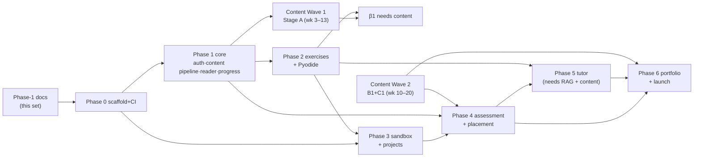

# IMPLEMENTATION_ROADMAP.md

**Project:** Data Science & AI Learning Academy ("DataVerse Academy")
**Phase:** 1 — Product Analysis & Planning
**Version:** 1.0.0-draft
**Date:** 2026-11-13
**Related:** all Phase-1 documents; this one sequences them

---

## Table of Contents

1. [Delivery Principles](#1-delivery-principles)
2. [Team & Staffing Assumption](#2-team--staffing-assumption)
3. [Phase-by-Phase Plan (v1: Weeks 1–24)](#3-phase-by-phase-plan-v1-weeks-124)
4. [Post-v1 Releases (v1.x, v2)](#4-post-v1-releases-v1x-v2)
5. [Dependency Map & Critical Path](#5-dependency-map--critical-path)
6. [Risk Register](#6-risk-register)
7. [Quality Gates, Definition of Done & QA Strategy](#7-quality-gates-definition-of-done--qa-strategy)
8. [Cost Model Sketch (estimates)](#8-cost-model-sketch-estimates)
9. [Change Control](#9-change-control)
10. [Phase 1 (this phase) Exit Summary: Decisions, Risks, Dependencies](#10-phase-1-this-phase-exit-summary)

---

## 1. Delivery Principles

1. **Vertical slices.** Every phase ends with something a real beginner can use end-to-end (a lesson that teaches, an exercise that grades), never a horizontal layer ("all models done").
2. **Content is the critical path.** Content tooling (linter, preview, term registry) ships in Phase 1, before content scale; authoring starts in Phase 1 (§3) — see risk R1.
3. **Docs are the contract.** PRD/architecture documents govern scope; changes go through §9 change control, not hallway agreements.
4. **Boring technology, strict boundaries.** No new infrastructure without an ADR; integration contract IC-1..IC-8 (`SYSTEM_ARCHITECTURE.md §3`) is enforced by CI from the first commit.
5. **Launch gates, not dates.** Phase exit criteria are quality gates; the calendar is an estimate (±20%), the gates are not negotiable.

---

## 2. Team & Staffing Assumption

| Role | Allocation | Notes |
|---|---|---|
| Full-stack engineer A (lead) | 1.0 | Next.js/TS domain + engines |
| Full-stack engineer B | 1.0 | Sandbox/exec/worker + tutor integration |
| Content lead (pedagogy + authoring) | 1.0 from wk 3 | Owns term registry, style, review |
| Content author #2 | 1.0 from wk 10 | Wave 2/3 capacity (R1 mitigation) |
| Product designer | 0.5 | Design system, widgets, a11y |
| Architect/PM (this role) | 0.2 | ADRs, gates, risk, change control |
| DevOps (shared) | 0.2 | Infra, CI/CD, observability |

Timelines below assume this staffing; §3 notes deltas for a 1-engineer team (+~60%).

---

## 3. Phase-by-Phase Plan (v1: Weeks 1–24)

### Phase 0 — Foundations & Guardrails (Weeks 1–2)

**Goal:** a repo where everything after is safe.

| # | Work |
|---|---|
| 0.1 | Monorepo scaffold per `SYSTEM_ARCHITECTURE.md §5.1` (pnpm workspaces, apps/web, packages/*, services/*, content/, infra/) |
| 0.2 | CI skeleton: typecheck, lint, unit, integration (docker-compose Postgres+Redis), path lint enforcing IC-1 namespace + IC-3 schema isolation |
| 0.3 | Prisma baseline + seed university (DATABASE §8.5); expand/contract migration policy wired |
| 0.4 | Design system v0: tokens, typography, dark mode, shadcn/ui base components, layout shell for `/academy/*` |
| 0.5 | **Integration re-verification:** re-run the repo inspection; if CodeVerse Academy source now exists, execute the IC contract against real host code *before* any scaffold build (PRD §11-A1) |
| 0.6 | Environments: local compose (Postgres, Redis, sandbox stub), staging deploy pipeline, feature flags (IC-7) |

**Exit:** CI green on a walking-skeleton lesson page rendered from seeded content; contract lints active.

### Phase 1 — Platform Core: "Can we teach a lesson?" (Weeks 3–5)

| # | Work | Maps to |
|---|---|---|
| 1.1 | Auth.js v5 (credentials + OAuth), roles, adapter interface (IC-4) | FR-01-01 |
| 1.2 | Content pipeline v1: content/ MDX+YAML → zod lint (schema, **term coverage**, reading level, Learning Loop completeness) → import → versioned publish → ISR revalidate | FR-15-01/02/04, FR-03-04 |
| 1.3 | Lesson reader: typed learning blocks, KaTeX, callouts, prev/next, resume, reading preferences, dark mode | FR-02-01..06, FR-16 |
| 1.4 | Term registry + inline first-use tooltips + glossary hub v1 | FR-03-01..03 |
| 1.5 | Progress engine v1: enrollments, lesson states, prerequisite DAG unlock (U-1..U-4) | FR-02-03, FR-08-01 |
| 1.6 | **Content Wave 1 begins:** A1 lessons authored into the pipeline (content author onboarded wk 3) | CURR §3 Stage A |

**Exit:** 10 published A1 lessons pass lint; an external test learner completes a lesson with progress + tooltips; author publishes without engineer help.
**Content milestone:** ≥ 15/60 Stage A lessons drafted.

### Phase 2 — Practice & Interactivity: "Every lesson does something" (Weeks 6–9)

| # | Work | Maps to |
|---|---|---|
| 2.1 | Exercise engine: 8 types (CURR §8.1), comparators, distractor rationale rendering, attempt persistence | FR-05-01..05 |
| 2.2 | In-lesson checks (L1) with instant feedback; hint ladder (3 levels) | FR-05-02/03, FR-06-01 |
| 2.3 | Pyodide tier: lazy runtime, IndexedDB cache, Web Worker, CodeMirror editor, test-case runner client-side | FR-07-01/03/04, NFR-03 |
| 2.4 | Widgets 1–2 (fair-share beam, distribution builder) + widget framework with keyboard a11y | FR-04-01, FR-16-01 |
| 2.5 | Error coach v1: curated rule table (top 12 beginner errors) + plain-English stderr mapper | FR-09-04 (deterministic part) |
| 2.6 | Progress dashboard v1 (track map, %, time, resume) | FR-08-01 |
| 2.7 | **Closed beta 1:** 10–15 target-persona testers (Maya/Raj/Lena profiles) on Stage A content; activation metric instrumented | PRD §9.1 |

**Exit:** β1 activation ≥ 50% (gate to proceed; ≥ 60% target at launch); every MVP lesson type renders + grades.
**Content milestone:** Stage A ≥ 24/60 published (A1–A2 complete, A3 drafting); β1 runs on A1–A2 content; full Stage A targeted by wk 13.

### Phase 3 — Sandbox & Real Code: "Heavy Python, safely" (Weeks 10–13)

| # | Work | Maps to |
|---|---|---|
| 3.1 | FastAPI runner service: container-per-job pool, no egress, nsjail/seccomp, cgroup caps, artifacts to object storage | FR-07-02, NFR-08 |
| 3.2 | BullMQ exec queue + workers; SSE push; Pyodide↔sandbox routing per exercise metadata | SYSTEM §6, §9.2 |
| 3.3 | Test-case grading server-side + artifact display (charts) + reset/diff views | FR-07-03/04 |
| 3.4 | Dataset panel: dataset registry, download, upload-your-own (projects only) | FR-07-05 |
| 3.5 | Sandbox quotas, anomaly alerts, cost dashboard v1 | NFR-13 |
| 3.6 | Guided-project machinery (steps + auto-checks); **P1 "Your First Analysis"** built with it | FR-10-01, CURR §10.1 |
| 3.7 | **Security review #1 (external if possible): sandbox escape resistance** — launch-blocking gate | NFR-08, R2 |

**Exit:** P90 sandbox latency < 10 s; escape review passed with no criticals; P1 playable end-to-end.
**Content milestone:** Stage A ≥ 55/60 published; Wave 2 (B1) drafting underway (author #2 onboarded wk 10).

### Phase 4 — Assessment & Mastery: "Progress means proof" (Weeks 14–16)

| # | Work | Maps to |
|---|---|---|
| 4.1 | Item pools + adaptive checkpoint draw (weak-outcome-first); checkpoint result screens with prescriptions | FR-06-02/03, CURR §9.3 |
| 4.2 | Mastery engine: evidence weighting, mastery states, dashboard mastery map | FR-08-02, CURR §9.5 |
| 4.3 | Course exams (timed, pooled) | FR-06-04 |
| 4.4 | Placement diagnostic v1: logic/math/spreadsheets sections, credit awarding (≥ 90% credit bar), study-plan generation (FR-01-02/04 preview) | FR-01-03, CURR §9.5 |
| 4.5 | Unlock v2: module gates live (U-2), placement credits (U-3), review-instead-of-repeat (U-5) | FR-02-03 |

**Exit:** placement→unlock loop verified in β; checkpoint first-attempt pass in the 60–85% band on real cohort data (else content fix loop, R6).
**Content milestone:** Stage A + B1 complete (84/84 published); C1 ≥ 8/24; MVP ≥ 92/108 drafted.

### Phase 5 — AI Tutor "Ada": "Never stuck, never spoiled" (Weeks 17–20)

| # | Work | maps to |
|---|---|---|
| 5.1 | RAG index pipeline (publish webhook → chunks → pgvector); retrieval quality eval set | FR-09-06, SYSTEM §7.3 |
| 5.2 | Tutor orchestrator: context builder, Socratic policy, hint-ladder interop, assessment-mode restrictions | FR-09-01/02/05, SYSTEM §7.4 |
| 5.3 | Model router + provider-neutral gateway + quotas + graceful fallback to authored hints | FR-09-07, SYSTEM §7.6 |
| 5.4 | Error coach ↔ tutor handoff (unmapped errors) | FR-09-04 |
| 5.5 | **Red-team suite in CI** (answer-extraction golden prompts, unsafe-content probes) | NFR-16 |
| 5.6 | **Tutor beta:** 30 learners; transcript sampling review; thumbs-up ≥ 4.2/5 gate | PRD §9.2 |

**Exit:** red-team suite green; tutor cost/active learner within budget (§8); policy violations in sampled transcripts < 1%.
**Content milestone:** **MVP curriculum 108/108 drafted; ≥ 100 published**, C1 ≥ 20/24 (final polish + P1 into Phase 6).

### Phase 6 — Portfolio, Placement polish & Launch (Weeks 21–24)

| # | Work | Maps to |
|---|---|---|
| 6.1 | Portfolio pages (public, shareable) + P1 showcase flow | FR-10-03/04 |
| 6.2 | Career readiness checklist ("job-ready when…") tied to live mastery data | FR-11-04 |
| 6.3 | Hardening: WCAG 2.2 AA audit + fixes, performance pass (NFR-01..03), sandbox load test (200 concurrent jobs), OWASP ASVS L2 pass, DR restore drill | NFR-01/04/08/10 |
| 6.4 | Analytics dashboards + alerting live; runbooks written | NFR-12 |
| 6.5 | **Launch beta (100–300 learners)** across all three persona archetypes; funnel instrumented | PRD §9.1 |
| 6.6 | Fix week + scope-cut decisions from beta data; **public v1 launch** | §9 gates |

**v1 launch gates (all must pass):** activation ≥ 60% in launch beta · D7 ≥ 25% · zero open critical security/a11y issues · sandbox + tutor cost within budget · support/abuse channels live · runbooks + on-call rotation documented.

**Content milestone at launch:** 108/108 MVP lessons published, lint-clean; term registry ~130 terms; 12 datasets; 2 widgets; P1 guided project.

---

## 4. Post-v1 Releases (v1.x, v2)

### v1.x "Analyst Complete" (Weeks 25–36, incremental releases)

| Release | Contents |
|---|---|
| v1.1 | Certificates (course + PDF + verify URL) FR-12; review queue (spaced repetition) FR-08-03 |
| v1.2 | Career Center: job profiles, interview bank, resume module FR-11-01..03; search FR-14 |
| v1.3 | Gamification: XP, streaks with freeze, badges FR-13; widgets 3–4 (sampling machine, JOIN visualizer) with C4/C5 |
| v1.4 | Courses B2–B4, C2–C6 (+104 lessons) → **Data Analyst track complete incl. capstone "City Insights Brief"**; placement Python/SQL sections; widgets 5–6; datasets to ~30 |
| v1.5 | Weekly digest email, PWA offline reading, polish + perf |

### v2 "Data Scientist & ML Engineer" (Months 10–18)

- Stage D courses D1–D7 (+108 lessons), Data Scientist capstone, ML Engineer capstone (P4–P6 projects)
- Widgets 7–8 (gradient descent slider, meaning map) with D5/D6
- Classroom/cohort mode (educator persona), mentor/human capstone review queue, peer gallery
- i18n infrastructure decision + first localization; free-response AI rubric grading
- Scale work per NFR-06 (replica, Meilisearch if ADR-008 triggered)

**Deliberately deferred indefinitely:** leaderboards (anti-beginner), proctoring, native apps, paid features (decision re-chartered post-v1 with real cost data).

---

## 5. Dependency Map & Critical Path

**Critical path:** content pipeline (Phase 1.2) → content Wave 1 → β1 → Wave 2 → Phase 4 placement validation → launch. **Code critical path:** sandbox (3.1) → grading → P1 project → capstone machinery (v1.4).

**External dependencies:** LLM provider account + budget approval (Phase 5); object storage + managed Postgres/Redis provisioning (Phase 0); external security review resource (Phase 3.7 — book in Phase 1); beta recruitment channels (Phase 2 — start recruiting Phase 1).

---

## 6. Risk Register

Top risks, ranked by exposure (probability × impact). Reviewed at every phase gate.

| ID | Risk | P | I | Mitigation | Trigger / early warning |
|---|---|---|---|---|---|
| **R1** | **Content is the schedule's critical path**: 6.5 h/lesson × 108 lessons ≈ 700 author-hours vs. content capacity; quality slips under pressure | High | High | Tooling-first (Phase 1 linter); author #2 from wk 10; MVP scope frozen (108 lessons, not 360); quality gate = lint + review checklist, no bypasses; scope-cut list pre-agreed (drop C1 stretch modules, ship 96 lessons) | < 40 lessons drafted by wk 12; review rework rate > 25% |
| **R2** | Sandbox escape / abuse of untrusted execution | Low | Critical | Defense-in-depth (container-per-job, no egress, nsjail+seccomp, caps, quotas, anomaly alerts); external review gate 3.7; private network + mTLS; abuse auto-pause | Any anomalous job pattern alert; pen-test finding rated high+ |
| **R3** | LLM/sandbox cost overrun under free access | Medium | High | Pyodide-first design (~60–70% of executions cost $0); model routing (40% deterministic); per-user quotas + degrade path; cost dashboards + hard budget alerts from Phase 3 | Cost/active learner > 150% of §8 budget for 2 consecutive weeks |
| **R4** | Tutor gives wrong info or leaks answers → beginner harm | Medium | High | Deterministic-first + RAG grounding; red-team CI suite; assessment-mode restrictions; transcript sampling; thumbs-down auto-flag review | Any policy violation in sampled transcripts; thumbs-up < 4.0/5 |
| **R5** | CodeVerse integration constraints change (host app appears with conflicting stack) | Medium | Medium | IC-1..8 contract enforced by CI from wk 1; adapter auth; isolated schema; re-verification step 0.5; no host dependency in runtime paths | Host repo detection at 0.5; host stack conflicts with Next 15/Tailwind pins |
| **R6** | Beginner experience misses (activation < gate) | Medium | High | β1 with real persona archetypes in Phase 2 (not Phase 6); "confusing" flag instrumented; placement friction-tested; reading-level lint | Activation < 50% at β1; lesson flag rate > 1% |
| **R7** | Scope creep ("just add X") | High | High | Scope frozen in PRD §10; all changes via §9; phase gates cite the PRD | > 2 scope additions/phase without removals |
| **R8** | Small team bus-factor / attrition | Medium | High | Docs-first (this set); boring stack; pairing on engines; everything in CI; runbooks | Any single-owner area with no second committer for 3 wks |
| **R9** | Placement mis-serves learners (false skips strand later; insulting repeats churn) | Medium | Medium | ≥ 90% credit bar; credit preview + one-click undo; U-5 review-instead-of-repeat; monitor credited-learner outcomes vs. matched non-credited | Credited learners' checkpoint pass < non-credited −10 pts |
| **R10** | DB/search performance at growth | Low | Medium | Index plan (DATABASE §5); monthly analytics partitions; replica at 10k MAU; ADR-008 search swap path | p95 lesson load > 1 s; search p95 > 500 ms |
| **R11** | LLM provider pricing/model change | Medium | Medium | Provider-neutral gateway port; deterministic fallbacks keep product usable without any LLM | Provider deprecation notice; price change > 2× |
| **R12** | Accessibility regressions in interactive surfaces (editor, widgets, drag exercises) | Medium | Medium | a11y in component DoD + axe in CI + per-release manual audit on widgets/editor/drag flows | Any axe critical in CI; audit finding > moderate |

---

## 7. Quality Gates, Definition of Done & QA Strategy

**Definition of Done (feature level):** unit tests for engines/grading (≥ 80% branch coverage on `academy-core`); integration test against docker-compose; Playwright e2e for learner-visible flow; axe a11y pass on new UI; keyboard-only walkthrough; content lint pass (if content); docs/ADR updated if architectural; feature flag default-off.

**Phase-gate QA matrix:**

| Gate | Checks |
|---|---|
| β1 (Phase 2) | e2e happy paths; activation instrumentation verified; a11y audit round 1; Pyodide load budget (NFR-03) |
| Sandbox review (3.7) | escape-attempt suite (egress, fork bombs, filesystem, resource exhaustion); caps enforced; artifacts isolated; **external review sign-off** |
| Phase 4 gate | checkpoint pass band 60–85% on β cohort; placement validity (score↔early-completion correlation ≥ 0.4) |
| Tutor gate (5.6) | red-team suite green; grounding eval (retrieval precision ≥ 0.85 on golden set); cost within budget |
| Launch gate (6.6) | full regression + load (200 concurrent sandbox jobs, 500 RPS reads); WCAG audit clean; OWASP ASVS L2; DR restore drill; runbooks; support loop live |

---

## 8. Cost Model Sketch (estimates)

*Planning estimates only — refine with real usage data at β1; assume ~500 MAU at launch, 5k MAU by month 6.*

| Item | Launch scale (mo) | 5k MAU (mo) | Notes |
|---|---|---|---|
| App hosting (Vercel or 2 VMs) | $0–80 | $100–200 | ISR-heavy; most reads CDN-cached |
| Managed Postgres (16 + PITR) | $60 | $150–250 | +replica at ~10k MAU |
| Managed Redis | $15 | $60 | |
| Sandbox compute (pool VMs/Fly) | $80–200 | $300–600 | Scales with heavy exercises; ~60–70% of executions stay in-browser (Pyodide) |
| Object storage + CDN | $30 | $100 | Datasets, artifacts, certs |
| Observability (Sentry, OTel) | $50 | $150 | |
| LLM tutor | ~$0.30–0.80 /active learner | $1,500–4,000 | Routing: ~40% deterministic, ~45% small model; quotas cap tail |
| **Total** | **≈ $300–500** | **≈ $2,400–5,400** | ≈ $0.50–1.10 per active learner/month |

Guardrails: hard budget alerts (R3), per-user daily tutor quota, sandbox CPU-minute caps, cost dashboards from Phase 3.

---

## 9. Change Control

1. Any scope/contract change → PR issue referencing the governing document section; architect + content lead approve.
2. PRD/architecture docs are versioned (`1.x` minor for clarifications, `2.0` for scope change); changelog section appended.
3. Phase gates may **cut** scope per pre-agreed cut-lists (R1) without a version bump; **adding** scope requires a 2.0 and explicit schedule re-plan.
4. ADRs (SYSTEM §14) are append-only; superseding requires a new ADR, never an edit.

---

## 10. Phase 1 (this phase) Exit Summary

**Delivered (this document set):** product definition, personas, outcomes, FR/NFR catalog (`PRODUCT_REQUIREMENTS.md`); system, sandbox, tutor, and deployment architecture + 10 ADRs (`SYSTEM_ARCHITECTURE.md`); pedagogy, full curriculum map (23 courses / 360 lessons full vision; 108-lesson MVP), assessment + content-production architecture (`CURRICULUM_ARCHITECTURE.md`); complete data model + Prisma draft (`DATABASE_DESIGN.md`); phased plan, dependency map, risk register, cost model (this document); acceptance-criteria detail (`FEATURE_SPECIFICATION.md`).

**Key architectural decisions (ADR summary — full rationale in SYSTEM §14):** standalone-first mount-ready module (ADR-001) · Next.js 15 monorepo with three URL-addressed services (ADR-002) · two-tier execution: Pyodide in-browser + Docker sandbox (ADR-003) · Prisma + PostgreSQL + pgvector, isolated `academy` schema (ADR-004, IC-3) · deterministic-first, RAG-grounded Socratic tutor (ADR-005) · content-as-code with versioned publish (ADR-006) · Server Actions by default (ADR-007) · Postgres FTS now, Meilisearch later (ADR-008) · BullMQ worker service (ADR-009) · mastery-based unlocks (ADR-010).

**Top risks to manage:** R1 content capacity (critical path) · R2 sandbox security · R3/R11 cost & provider exposure · R4 tutor policy/hallucination · R6 beginner-experience miss · R5 host-integration unknowns.

**Critical dependencies:** content pipeline before content scale · sandbox before heavy exercises/projects · mastery engine before placement/checkpoints · RAG index before tutor · external security review booked by Phase 1 · beta recruitment starting Phase 1.

**Immediate next actions (Phase 0 entry):** (1) re-verify repository state vs. this plan's §2 findings; (2) approve this document set as the v1 contract; (3) scaffold monorepo + CI guardrails; (4) onboard content lead; (5) book external sandbox security review for Phase 3.

---

*No application implementation has begun, per the Phase-1 brief. Implementation starts at Phase 0 upon approval of this document set.*
