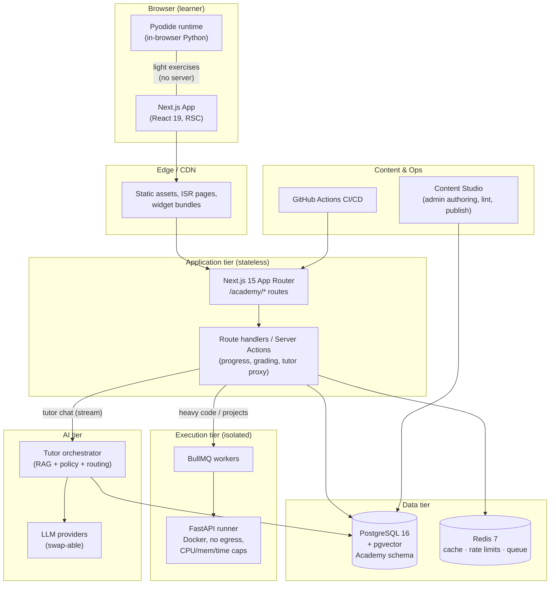
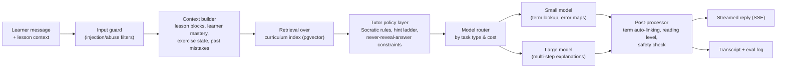
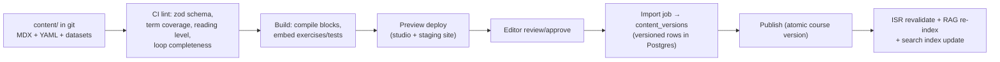
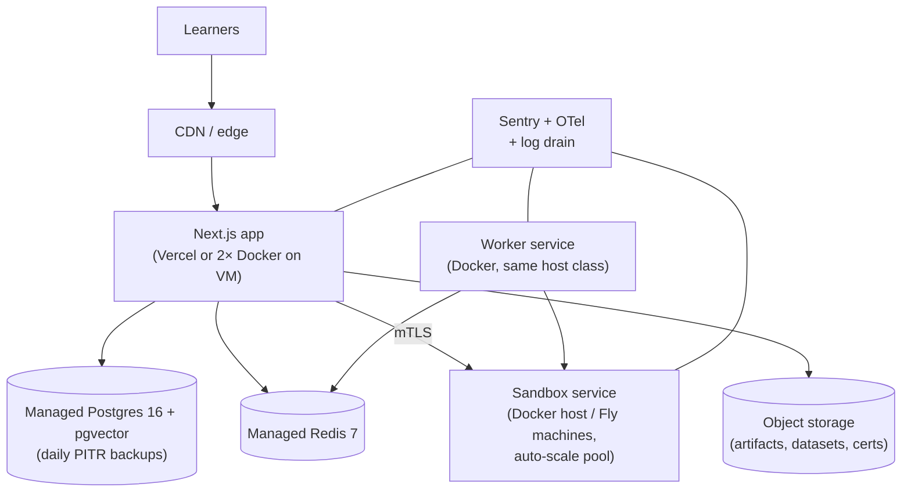

# SYSTEM_ARCHITECTURE.md

**Project:** Data Science & AI Learning Academy ("DataVerse Academy")
**Phase:** 1 — Product Analysis & Planning
**Version:** 1.0.0-draft
**Date:** 2026-11-13
**Related:** `PRODUCT_REQUIREMENTS.md` (FR/NFR IDs used below), `CURRICULUM_ARCHITECTURE.md`, `DATABASE_DESIGN.md`

---

## Table of Contents

1. [Architecture Goals & Driving Constraints](#1-architecture-goals--driving-constraints)
2. [High-Level System Overview](#2-high-level-system-overview)
3. [Module Boundary & CodeVerse Integration Contract](#3-module-boundary--codeverse-integration-contract)
4. [Technology Stack & Rationale](#4-technology-stack--rationale)
5. [Application Architecture (Next.js)](#5-application-architecture-nextjs)
6. [Code Execution Architecture](#6-code-execution-architecture)
7. [AI Tutoring Architecture](#7-ai-tutoring-architecture)
8. [Content Management Pipeline](#8-content-management-pipeline)
9. [Caching & Background Jobs](#9-caching--background-jobs)
10. [Security Architecture](#10-security-architecture)
11. [Deployment Architecture](#11-deployment-architecture)
12. [Observability & Analytics](#12-observability--analytics)
13. [Failure Modes & graceful Degradation](#13-failure-modes--graceful-degradation)
14. [Architectural Decision Records (ADR Summary)](#14-architectural-decision-records-adr-summary)

---

## 1. Architecture Goals & Driving Constraints

**Goals (derived from NFRs and product principles):**

1. **Beginner-safe by default** — no learner action can corrupt state; every interactive surface degrades gracefully.
2. **Modular and mountable** — the Academy is a self-contained module (`/academy/*`) that can run standalone **or** be mounted into a host application (CodeVerse Academy) without touching host internals.
3. **Cheap per learner at rest** — reading is static/CDN-cached; interactive compute (sandbox, tutor) is the only marginal cost and is budgeted and capped.
4. **Content-as-code with runtime authoring** — lessons live in git (reviewable) and are imported into a versioned content store; authors preview before publish.
5. **Observable and reversible** — every subsystem has health, cost, and error signals; feature flags gate every user-facing subsystem.

**Driving constraints:** free-core access model (cost-sensitive), zero-install requirement through Course C (browser-first execution), single small team (favor boring, well-documented technology), Phase-1 deliverable is documentation only.

---

## 2. High-Level System Overview



**Key property:** the browser runs light Python exercises itself (Pyodide). Only heavy jobs (pandas/sklearn on real datasets, capstones) reach the sandbox tier. This keeps marginal compute cost near zero for the majority of interactions.

---

## 3. Module Boundary & CodeVerse Integration Contract

### 3.1 Findings recap

The working repository contains **no CodeVerse Academy source** (verified by direct inspection: git tree, filesystem sweep — see `PRODUCT_REQUIREMENTS.md §2`). Therefore the Academy is architected **standalone-first with a host-mount contract**, so that integration later is additive and non-breaking.

### 3.2 The integration contract (binding rules)

| # | Rule | Enforcement |
|---|---|---|
| IC-1 | **All Academy routes live under `/academy/*`** in a single route group `src/app/academy/` (or `modules/academy/app/`). No route outside the namespace is added or edited. | Directory layout + CI path lint |
| IC-2 | **Single navigation entry**: the host adds exactly one nav item ("Data Science & AI Academy") pointing to `/academy`. No host UI files are modified beyond that entry. | Integration guide documents the one-line change |
| IC-3 | **All Academy database tables live in an isolated Postgres schema** (`academy`) with no FKs into host tables; the only join key is `user_id` (opaque string). | Prisma schema `schemas` config; migration review |
| IC-4 | **Auth is pluggable**: standalone mode uses Auth.js credentials/OAuth; host-mounted mode reuses the host session via an adapter (`SessionProvider` interface). No second login screen when mounted. | `packages/auth-adapter` |
| IC-5 | **No duplicate systems**: the Academy implements its own curriculum/tutor/progress domain only. Any pre-existing host "AI From Scratch"-style modules remain untouched; no imports from Academy into host modules and vice versa except through published interfaces. | Module lint (dependency-cruiser) |
| IC-6 | **Styles/components**: Academy uses its own component layer built on shadcn/ui primitives; theme tokens map to host tokens where present (CSS variables), so it inherits the host look without styling host pages. | Tailwind preset |
| IC-7 | **Feature-flagged mount**: `ACADEMY_ENABLED` env flag allows the host to disable the module entirely with zero dangling routes. | Middleware flag check |
| IC-8 | **Version compatibility**: dependencies are chosen to be compatible with a typical Next.js 15 / React 19 host; when a host repo exists, its `package.json` wins — **never upgrade host dependencies for Academy needs**; adapt the Academy instead. | ADR-001 policy |

### 3.3 Standalone deployment vs mounted deployment

| Aspect | Standalone (v1 launch) | Mounted in CodeVerse (later) |
|---|---|---|
| App | Own Next.js app | Route group inside host app |
| Auth | Auth.js own user base | Host session adapter (IC-4) |
| Database | Own Postgres, `academy` schema | Same Postgres or separate DB; same isolated schema |
| Sandbox/AI/Redis | Shared services either way (they are URL-addressed, not code-linked) | Same |
| Nav | Full site chrome | Single entry (IC-2) |

The sandbox, tutor orchestrator, and workers are **separate URL-addressed services** precisely so they never create code-level coupling with any host app.

---

## 4. Technology Stack & Rationale

| Layer | Choice | Version (pin at kickoff) | Rationale / Compatibility rule |
|---|---|---|---|
| Framework | Next.js (App Router, RSC) | 15.x (latest stable 15) | User-specified; RSC + ISR fit content-heavy pages; standalone mount compatible. If a host repo pins a different major, **host wins** (IC-8) |
| UI | React | 19.x | Required by Next 15; matches user spec |
| Language | TypeScript | 5.x, `strict` | End-to-end types (content schema → UI → DB) |
| Styling | Tailwind CSS | 4.x (3.x if host pins 3) | Utility CSS, themeable via CSS variables; matches host expectations |
| Components | shadcn/ui (Radix primitives) | current | Copy-in components (no runtime dep lock-in), accessible by default (NFR-10) |
| Database | PostgreSQL | 16 | One engine for relational + vector (`pgvector`) needs; mature ops |
| ORM | Prisma | 6.x | Team velocity, typed schema, migrations; schema-per-module support. (Drizzle acceptable if a host repo already uses it — IC-8) |
| Auth | Auth.js (NextAuth) | v5 | Credentials + OAuth; adapter pattern enables host-session reuse (IC-4) |
| Cache/queue | Redis | 7.x | Sessions cache, rate limits, BullMQ queues |
| Job queue | BullMQ | 5.x | Runs as separate worker process; no serverless coupling |
| In-browser Python | Pyodide | latest stable, pinned | Zero-install learner exercises (FR-07-01) |
| Sandbox runner | FastAPI + Python | 3.12 | Thin, typed execution service; isolated in Docker (FR-07-02) |
| Container isolation | Docker + nsjail (seccomp, no network) | — | Defense-in-depth for untrusted code (NFR-08) |
| Math rendering | KaTeX | latest | Fast, accessible formulas |
| Editor | CodeMirror 6 | 6.x | Lightweight, mobile-tolerant, Python syntax support |
| Search | Postgres FTS → Meilisearch later | — | Start simple; swap path defined (ADR-008) |
| AI provider | Swap-able LLM gateway (provider-neutral) | — | See §7.6; never hard-code one vendor |
| Vector store | pgvector (inside Postgres) | 0.7+ | No new datastore; curriculum-scale corpora fit comfortably |
| CI/CD | GitHub Actions | — | Standard; required checks defined in §11 |
| Observability | Sentry + OpenTelemetry + structured logs | — | NFR-12 |
| Email | Resend (or host's provider) | — | Digests, verification (FR-01, FR-08-04) |

**Explicitly deferred:** Kubernetes, microservice split beyond the three URL-addressed services (app, sandbox, worker), ClickHouse/analytics warehouse, feature-flag SaaS (start with env + DB flags).

---

## 5. Application Architecture (Next.js)

### 5.1 Repository layout (monorepo, pnpm workspaces)

```
dataverse-academy/
├── apps/
│   └── web/                      # Next.js 15 app (standalone launch; mountable later)
│       └── src/app/
│           ├── (marketing)/      # public pages: home, about, pricing(=free), careers
│           └── academy/          # ★ IC-1: everything learner-facing under /academy
│               ├── (learn)/      # tracks, courses, modules, lessons/[slug]
│               ├── (practice)/   # exercises, projects, sandbox playground
│               ├── (assess)/     # checkpoints, exams, certificates
│               ├── (career)/     # career center, portfolio
│               ├── (account)/    # profile, settings, progress dashboard
│               └── studio/       # admin/content authoring (role-gated)
├── packages/
│   ├── academy-core/             # domain logic: progress engine, mastery engine, grading
│   ├── content-schema/           # zod schemas for lessons/term registry (shared with pipeline)
│   ├── ui/                       # Academy component layer (shadcn-based), widgets
│   ├── auth-adapter/             # IC-4 SessionProvider interface + Auth.js impl
│   ├── executor-client/          # typed client for sandbox + Pyodide runner glue
│   └── tutor/                    # tutor orchestrator (policy, RAG, routing) — callable service
├── services/
│   ├── sandbox/                  # FastAPI execution service (Docker)
│   └── worker/                   # BullMQ workers (grading, RAG indexing, emails, PDFs)
├── content/                      # ★ content-as-code: courses/**/lesson.mdx + term-registry.yaml
├── infra/                        # docker-compose (dev), Terraform/infra-as-code, migration dirs
└── docs/                         # these Phase-1 documents
```

### 5.2 Rendering & caching strategy per page class

| Page class | Strategy | Reason |
|---|---|---|
| Marketing, course catalog, lesson reading pages | ISR (revalidate on publish webhook) + CDN | Content changes only on publish; near-zero marginal cost |
| Lesson page *interactive state* (progress ticks, exercise results) | Client components → Server Actions | Fresh data without full reload |
| Dashboard, portfolio, studio | Dynamic (RSC), per-user | Personalized |
| Glossary | ISR + client-side fuzzy search | Term registry changes rarely |

### 5.3 Server actions vs API routes

Default: **Server Actions** for mutations from RSC pages (less API surface to secure). Route handlers used only where a non-Next client calls in: sandbox callback, tutor SSE/streaming endpoint, webhooks (content publish), health probes.

### 5.4 Domain engines (in `academy-core`, pure TypeScript, fully unit-tested)

| Engine | Responsibility |
|---|---|
| **Progress engine** | Lesson/module/course state transitions, unlock evaluation from prerequisite DAG + placement credits |
| **Mastery engine** | Evidence-weighted outcome scoring (exercise, check, checkpoint, spaced-review results → strong/developing/needs-review) |
| **Grading engine** | Objective grading (comparators per question type), distractor rationale selection, test-case comparison for code |
| **Review scheduler** | SM-2-lite spaced repetition queue (FR-08-03) |
| **Placement engine** | Diagnostic flow control, credit awarding rules |

Engines are pure functions over typed inputs — no I/O — so they are testable and reusable by both actions and workers.

---

## 6. Code Execution Architecture

Two tiers, chosen per exercise by content metadata (`runtime: "pyodide" | "sandbox"`).

### 6.1 Tier 1 — In-browser (Pyodide)

- **Use for:** pure Python, small pandas/numpy (bundled wheels), logic exercises, Parsons checkers.
- **How:** Pyodide loaded lazily from CDN on first code exercise, cached in IndexedDB thereafter (NFR-03). Runs in a Web Worker so the UI never blocks. Test cases and a trimmed `pandas` wheel are part of the lesson bundle.
- **Why:** zero marginal cost, zero latency, works offline-ish (PWA), removes "my code broke the server" fear — a real beginner-psychology win.

### 6.2 Tier 2 — Cloud sandbox (FastAPI + Docker)

- **Use for:** sklearn training, matplotlib rendering, dataset-heavy work, guided projects, capstones (Course C onward).
- **Flow:** Submit → API validates (size, rate, quota) → BullMQ job → worker starts a **container-per-job** (pool pre-warmed) → executes against pinned dataset snapshot → captures stdout, stderr, exit code, generated artifacts (charts), test results → stores `submission_result` → SSE/websocket push to UI.
- **Isolation (defense in depth):** Docker with `--network none`, read-only rootfs, non-root UID, seccomp + nsjail inner sandbox, cgroup caps (CPU s, memory MB, wall time — values per exercise class, e.g. 10 s/512 MB/60 s), ephemeral temp dir, no host mounts. Jobs killed at limits with a **plain-English timeout message** (product principle: every error teaches).
- **Artifacts:** charts/PNGs and CSVs stored in object storage (S3-compatible), served via signed URLs; code snapshots attached to submissions (FR-10-04).
- **Abuse controls:** per-user daily CPU-minute quota, concurrency 1–2, global queue back-pressure; anomaly alerts (fork bombs, crypto patterns) → auto-pause account.

### 6.3 Error coaching (cross-cutting)

Both tiers feed stderr/exception through the **error coach**: a curated mapping table (20 most common beginner errors per course) plus tutor fallback for unmapped errors (FR-09-04). Learners see: what happened → why (plain English) → 3-step fix.

---

## 7. AI Tutoring Architecture

### 7.1 Design stance

The tutor ("Ada") is a **guided Socratic assistant scoped to the curriculum**, not a general chatbot. Its job is to unblock the learner *without* destroying learning (FR-09-02) and to explain every term it uses (FR-09-03).

### 7.2 Components



### 7.3 Grounding & anti-hallucination (FR-09-06)

1. **RAG over the curriculum**: every published lesson, glossary term, worked example, and exercise is chunked and embedded into pgvector at publish time (worker job). Tutor answers are generated with retrieved curriculum context and instructed to stay within it.
2. **Deterministic fallbacks first**: term questions are answered from the term registry (no generation); mapped errors from the error table (no generation). LLM generation is the *second* path, not the first — this both improves accuracy and cuts cost.
3. **Post-processor** re-links registry terms in replies and flags sentences contradicting retrieved sources (citation required for code syntax claims).

### 7.4 Socratic policy (FR-09-02)

- System contract: "never output a direct solution to an active exercise or assessment; respond with at most the next hint level; use worked analogies from the lesson."
- Hint ladder interop: exercise hint levels 1–3 are **authored** (deterministic); the tutor only elaborates on the current level, never skips ahead.
- Assessment mode: during checkpoints, tutor is restricted to logistics ("how navigation works"), not content.
- Enforcement: automated red-team suite in CI — golden prompts attempt to extract answers; responses failing policy fail the build (NFR-16).

### 7.5 Personalization inputs

Current lesson + block, learner mastery vector, last 3 mistakes (with what finally worked), placement credits, reading preference. All from the context builder — never raw chat history beyond the active session (privacy + token cost).

### 7.6 Model routing & cost control (NFR-13)

| Task | Route | Est. share |
|---|---|---|
| Term lookup / simple error map | No LLM (registry/table) | ~40% |
| Standard Socratic turn | Small model | ~45% |
| Complex multi-step explanation, project feedback | Large model | ~15% |

Controls: per-learner daily message quota (soft cap + degrade to authored hints, FR-09-07), response length caps, prompt caching, provider-neutral gateway interface (`LLMProvider` port) so providers swap without app changes.

### 7.7 Transcript handling

Tutor sessions logged with `ai_usage` records (tokens, cost, latency, model) for cost dashboards; transcripts reviewable by admins when learners flag (abuse + quality); auto-purged per retention policy (§10.5).

---

## 8. Content Management Pipeline

(Full authoring workflow and curriculum structure: `CURRICULUM_ARCHITECTURE.md §10–11`. This section is the technical pipeline.)



- **Content-as-code**: git is the source of truth; the Content Studio (FR-15) imports, previews, and publishes — never forks a second source of truth.
- **Versioning**: every publish creates an immutable course version; learner progress references the version it belongs to (so mid-course edits never strand learners); diffs shown in studio.
- **Linter rules (blocking)**: undefined terms (FR-03-04), reading level, Learning Loop completeness (§CURR-5), orphan exercises, outcome coverage (§CURR-6.3).

---

## 9. Caching & Background Jobs

### 9.1 Caching layers

| Layer | Contents | TTL / invalidation |
|---|---|---|
| CDN | Static assets, ISR lesson pages | Publish webhook purge |
| Next.js data cache | Catalog queries, glossary | Tag-based (`revalidateTag` on publish) |
| Redis | Session cache, rate-limit counters, exercise hint pre-fetch, hot glossary | 5–60 min |
| Browser | Pyodide runtime + datasets (IndexedDB), PWA lesson shell | Versioned |

### 9.2 Background jobs (BullMQ)

| Queue | Jobs | Notes |
|---|---|---|
| `exec` | Sandbox executions, grading | Priority lanes: interactive (high) vs project (normal) |
| `content` | Import, publish, RAG re-index, search sync | Publish webhook triggered |
| `comms` | Emails (verification, digest), certificate PDF generation | Retry with backoff |
| `maintenance` | Streak rollups, review-queue scheduling, retention purges, cost aggregation | Nightly cron |

Workers run as a separate service (`services/worker`) — never inside Next.js request handlers.

---

## 10. Security Architecture

### 10.1 Authentication & authorization

- Auth.js v5: email/password (bcrypt/argon2id) + Google/GitHub OAuth; session in HttpOnly cookie; adapter interface for host mount (IC-4).
- **RBAC roles:** `learner`, `author`, `admin` (+ `host_admin` in mounted mode). Studio and admin routes role-gated at layout + action level (defense in depth).
- Route-level rate limits (Redis token bucket) on auth, tutor, sandbox submit, search.

### 10.2 Learner-data protection

- Data minimization: no third-party trackers beyond consent-gated product analytics; no PII in logs (structured log scrubber).
- GDPR endpoints: export account data (JSON), delete account (soft → hard purge job including object storage artifacts; anonymized analytics retained).
- Tutor transcripts and code submissions are learner data — same retention/purge rules apply.

### 10.3 Untrusted code (recap of §6.2)

Container-per-job, no egress, resource caps, non-root, seccomp/nsjail, quotas, anomaly alerts. Sandbox service is on a private network, reachable only from the app/worker tier via mTLS.

### 10.4 Content & prompt security

- Content inputs (MDX) sanitized at build; only an allowlisted block vocabulary is rendered (no raw HTML).
- Tutor input guard: injection-pattern filters + system prompt isolation of exercise answers; output safety check (NFR-16).
- CSP on all pages; SRI for CDN assets; dependency audit + Dependabot in CI.

### 10.5 Retention

| Data | Retention |
|---|---|
| Account, progress, submissions | Life of account + 30 d soft delete |
| Tutor transcripts | 90 d rolling (unless flagged) |
| Analytics events | Aggregates kept 25 mo; raw events 13 mo |
| Execution artifacts | 12 mo, then purge |

---

## 11. Deployment Architecture

### 11.1 Environments

| Env | Purpose | Data |
|---|---|---|
| `dev` | Local docker-compose (Postgres, Redis, sandbox, worker) | Seed content |
| `staging` | Preview + content preview + red-team tutor suite | Anonymized |
| `prod` | Public | Real |

### 11.2 Production topology (v1, single region)



- **Rationale:** managed DB/Redis (small team, ops economy); sandbox on separate compute (Fly.io machines or a dedicated VM host with Docker) — **isolated from app tier** so a sandbox incident cannot touch learner data; the app itself is deployable to Vercel or any container host without change (both targets supported by the same Docker-composable local dev).
- **Scaling path:** app tier is stateless → horizontal; sandbox pool auto-scales on queue depth; Postgres reads → replica at ~10k MAU; search → Meilisearch when FTS quality hurts (ADR-008).

### 11.3 CI/CD (GitHub Actions)

PR: typecheck → lint → unit (engines, grading) → integration (docker-compose: Postgres + Redis + sandbox) → content lint (if `content/` touched) → tutor red-team suite (if `packages/tutor` touched) → a11y smoke (Playwright + axe on key flows).
Main: build images → deploy staging → smoke suite → manual gate → prod. Migrations run as gated deploy step (expand-migrate-contract pattern; never destructive in the same release).

### 11.4 DR & backups

Postgres PITR daily + 7 retention points; object storage versioning; RPO ≤ 24 h, RTO ≤ 4 h for v1 (documented runbook); sandbox and tutor are stateless → redeploy from images.

---

## 12. Observability & Analytics

- **Sentry** (errors, session replay opt-in), **OpenTelemetry traces** across web → worker → sandbox → tutor.
- **Dashboards:** lesson p95 latency, sandbox queue depth/p95/failure, tutor latency/cost/day, DB slow queries, publish pipeline duration.
- **Alerts:** sandbox failure spike, tutor cost > daily budget, publish pipeline failing, queue saturation, error-rate SLO burn.
- **Product analytics:** first-party event pipeline (the taxonomy in `PRODUCT_REQUIREMENTS.md §9.3`) → Postgres `analytics_events` (partitioned monthly) with consent gating; no third-party trackers.

---

## 13. Failure Modes & Graceful Degradation

| Failure | Learner experience | System behavior |
|---|---|---|
| Sandbox down/saturated | Message: "Hands-on lab is warming up — reading and quizzes unaffected" (NFR-05); exercises switch to read-only with Parsons fallbacks where possible | Queue back-pressure + status banner; heavy jobs retried |
| Tutor provider down / quota | Falls back to authored hint ladder + curated error map | Circuit breaker per provider; status chip on tutor panel |
| Redis down | Slower auth/rate checks, degraded caching | App fails open on cache reads, closed on auth-critical paths with direct DB verification |
| Postgres down | Read-only maintenance page | Health-gated deploy, PITR restore runbook |
| CDN/PWA cache stale after publish | Learner sees "New version available — refresh" toast (progress never lost) | Client-side version handshake |

---

## 14. Architectural Decision Records (ADR Summary)

| ADR | Decision | Why | Alternatives rejected |
|---|---|---|---|
| ADR-001 | **Standalone-first, mount-ready module** (`/academy` namespace, isolated schema, adapter auth) | No host repo exists (verified); contract makes later CodeVerse integration additive and non-breaking | Building inside a hypothetical host; or a hard-coupled subsite |
| ADR-002 | **Next.js 15 + React 19 monorepo** (single deployable app + URL-addressed services) | Team size, RSC/ISR fit for content-heavy pages, mount compatibility | Microservices per domain; separate SPA + API |
| ADR-003 | **Two-tier execution: Pyodide in-browser + Docker sandbox** | ~zero cost & latency for most exercises; real isolation only where needed | JupyterHub for everything (heavy, ops-costly); pure serverless functions (Python cold starts, egress risk) |
| ADR-004 | **Prisma + PostgreSQL 16 (single engine incl. pgvector)** | One database to operate; typed schema; vector + relational + FTS in one place | Separate vector DB (Pinecone et al.) — extra vendor/cost for curriculum-scale corpora |
| ADR-005 | **Tutor = deterministic-first (registry/tables), LLM second, RAG-grounded** | Accuracy for beginners, cost control, policy enforcement | Pure LLM chatbot (hallucination risk to beginners is unacceptable) |
| ADR-006 | **Content-as-code in git + versioned publish into DB** | Reviewable content, reproducible builds, author safety net | DB-only CMS (no review trail) or git-only (no studio preview/rollback) |
| ADR-007 | **Server Actions by default; route handlers only for non-page clients & streams** | Smaller security surface, less boilerplate | REST for everything |
| ADR-008 | **Postgres FTS now, Meilisearch later (port interface)** | Boring start; swap path defined | Search SaaS on day one |
| ADR-009 | **BullMQ workers as separate service** | Long jobs (executions, PDFs, indexing) must not live in request path | In-process queues (block serverless), cloud queues (extra vendor) |
| ADR-010 | **Mastery-based unlocks (not completion-based)** | Product principle: exercises → assessments must *mean* something | "Mark as complete" free navigation (undermines zero-prerequisite promise) |

---

*Next: curriculum and assessment design → `CURRICULUM_ARCHITECTURE.md`; data model for everything above → `DATABASE_DESIGN.md`; sequencing, risks, and estimates → `IMPLEMENTATION_ROADMAP.md`.*
