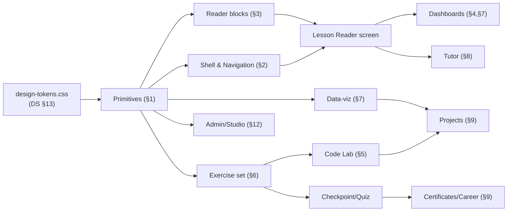

# COMPONENT_INVENTORY.md

**Product:** DataVerse Academy
**Phase:** 2 — Experience Design (component library)
**Version:** 1.0.0
**Date:** 2026-11-14
**Related:** `DESIGN_SYSTEM.md` (tokens), `SCREEN_DESIGNS.md` (usage), `INTERACTION_SPECIFICATION.md` (behavior), `RESPONSIVE_BEHAVIOUR.md` (adaptation)

**Conventions.** Every component is a shadcn/ui composition (Radix primitive inside) unless marked *custom* (domain-specific, built on primitives). Variants/states use `class-variance-authority`; all colors/spacing/motion come exclusively from `--dv-*` tokens. Each entry lists: **anatomy · variants · states · a11y · rules**. Status column: ● v1 MVP · ◐ v1.x · ○ v2.

---

## Table of Contents

1. [Foundations (primitives)](#1-foundations-primitives)
2. [Navigation & Shell](#2-navigation--shell)
3. [Learning — Lesson Reader blocks](#3-learning--lesson-reader-blocks)
4. [Learning — Navigation & progress](#4-learning--navigation--progress)
5. [Practice — Code Lab](#5-practice--code-lab)
6. [Practice — Exercises & Assessment](#6-practice--exercises--assessment)
7. [Data Visualization](#7-data-visualization)
8. [AI Tutor ("Ada")](#8-ai-tutor-ada)
9. [Projects, Portfolio & Career](#9-projects-portfolio--career)
10. [Collections & Cards](#10-collections--cards)
11. [Feedback, States & Overlays](#11-feedback-states--overlays)
12. [Account, Admin & Studio](#12-account-admin--studio)
13. [Dependency & build order](#13-dependency--build-order)

---

## 1. Foundations (primitives)

| Component | Variants | States | Notes / a11y | Status |
|---|---|---|---|---|
| **Button** | primary (teal-700 fill) · secondary (surface + border) · ghost · danger · link | default · hover · active · focus-visible · loading (spinner+label swap) · disabled (48% opacity, cursor not-allowed) | ≥ 44 px height (lg 48, sm 36 with 40 target via pseudo); loading never removes label; icon+label gap 8 | ● |
| **IconButton** | sizes 32/40/44 | as Button | mandatory `aria-label` + tooltip | ● |
| **Input / Textarea** | default · inset (surface-inset bg) | default · hover (border-strong) · focus (2px ring) · error · disabled · readonly | label + `aria-describedby` (hint + error slots); error shows icon + text | ● |
| **Select / Combobox** | native (mobile) · command list (desktop) | closed · open · loading · empty | Radix Listbox pattern; type-ahead; selected ✓ | ● |
| **Checkbox / RadioGroup / Switch** | — | checked · unchecked · indeterminate · disabled · invalid | 20 px control, 44 px target; Switch only for reversible prefs | ● |
| **Slider** | single · range | drag · keyboard (arrow ±step, PgUp ±10) | `role="slider"` + value bubble; used by widgets | ● |
| **Badge** | neutral · teal (progress) · gold (achievement) · semantic (success/warn/danger/info) · outline | — | 12 px caption, uppercase off; never color-only (icon or text) | ● |
| **Chip / Tag** | filter (removable) · static · term-chip (glossary link) | on · off · hover | Term chips carry tooltip preview | ● |
| **Avatar** | 24/32/40 | image · initials (teal-25 bg) | — | ● |
| **Tooltip (system)** | — | hover-intent 300 ms · focus-instant | Radix Tooltip; 280 ms close delay; never holds unique info | ● |
| **Kbd** | — | — | Renders `<kbd>`; ⌘/⌥/⇧ symbols + aria text | ● |
| **Progress bar** | determinate · indeterminate (labeled) | — | `role="progressbar"`, value announced politely | ● |
| **ProgressRing** | 24 (inline) · 40 (rows) · 96 (heroes) | — | `role="meter"`; number centered (tabular); draw animates once (§DS-9.3) | ● |
| **Skeleton** | text · block · circle | — | 200 ms display delay; shimmer respects reduced motion (static) | ● |
| **Tabs** | underline · pill | — | Radix Tabs; arrow-key navigation; content in `tabpanel` | ● |
| **Accordion** | single · multi | open · closed · chevron 200 ms | Used for syllabus, FAQ, code "go deeper" | ● |
| **Table** | data (sortable) · definition | sorted asc/desc · loading (skeleton rows) | `<table>` semantics; sticky header; row hover surface-subtle; numeric cells tabular right-aligned | ● |
| **Divider** | hairline · labeled | — | — | ● |
| **SegmentedControl** | 2–4 options | selected (teal-25 bg + teal-700 text) | radiogroup pattern; used for theme, view switches | ● |
| **EmptyState** | first-use · no-results · error-adjacent | — | icon 24 + one-line teaching tip + single primary action (DS §12 voice) | ● |

## 2. Navigation & Shell

| Component | Anatomy | Variants / States | Rules | Status |
|---|---|---|---|---|
| **MarketingNav** *(custom)* | logo lockup · primary links (Courses, Schools, Roadmaps, Practice, Glossary, Career) · Search trigger (⌘K) · ThemeToggle · Sign in / Avatar menu | top · scrolled (blur bg-surface/80 + hairline) | Height 64; hides links < lg → hamburger sheet; active link teal-700 + underline offset 8 | ● |
| **AppNav** *(custom)* | logo-sm · breadcrumb · contextual actions (Search, Theme, Avatar) | — | Height 56; replaces MarketingNav inside app contexts | ● |
| **SideNav** *(custom)* | section groups · items (icon + label) · collapse-to-rail (64 px) | expanded · rail · mobile-sheet | Item states: current (teal-25 bg, teal-700 text, 3 px left bar) · hover · disabled+reason tooltip | ● |
| **Breadcrumb** | root (Academy) · context crumb · current | — | Collapses middle > 2 with "…"; `aria-current="page"` | ● |
| **SearchTrigger / CommandPalette** *(custom on Radix Dialog + cmdk)* | trigger (icon + "Search" + Kbd ⌘K) · palette (input · grouped results · footer hints) | idle · typing · loading · empty ("No matches — check spelling or browse Glossary") | Groups: Jump to / Lessons / Terms / Exercises / Projects / Actions; recent items persisted; arrow keys + Enter; full spec INTERACTION §6 | ● |
| **Sheet** *(Radix Dialog side)* | left (navigation) · right (context panels) · bottom (mobile actions) | — | 92% width ≤ 480 px; focus trap; swipe-to-close (touch); overlay scrim 40% ink | ● |
| **PageHeader** | eyebrow · title (display) · description · actions row | with-hero (school pages) · compact | — | ● |
| **Footer** | 4 sitemap columns · brand + mission line · legal (Privacy, Terms, Accessibility statement) · status link | — | Appears only on marketing screens | ● |
| **ThemeToggle** *(custom)* | segmented Light/System/Dark with icons | per-mode | DS §10.3; lives in navbar + Profile | ● |
| **UserMenu** *(Radix DropdownMenu)* | avatar · name+email · items (Profile, Bookmarks, Preferences, Certificates, Sign out) | — | — | ● |

## 3. Learning — Lesson Reader blocks

The reader renders typed **Learning Loop blocks** (CURR §5) — each block is a component:

| Block component | Anatomy | Rules | Status |
|---|---|---|---|
| **WhyCallout** | target icon · "Why this matters" label · 3–5 sentence body · job-skill chip | surface-subtle bg, teal-700 left rule 3 px; first block of every lesson | ● |
| **Prose** | paragraphs · links · inline code (`code-sm`, surface-inset bg, r-sm) | 68ch, body-lg, reading-font pref; `text-wrap: pretty` | ● |
| **TermRef** *(custom)* | dotted-underline term · hover/focus tooltip | Tooltip: term (heading-sm) + definition (body-sm) + micro-example (caption, italic) + "Hear it from Ada →" link; full spec INTERACTION §4.1 | ● |
| **TermsCard** | "Terms introduced" · term rows (term + one-line definition) | Auto-generated from registry; each row links to Glossary entry | ● |
| **Figure** | framed image/SVG (r-lg, e1, border) · caption (caption, ink-3) · optional "Read as table" disclosure | Diagrams per DS §8.3; figure has `role="group"` + aria-label | ● |
| **MathBlock** | KaTeX display · "Say it" pronunciation toggle · symbol legend chips | Legend chips list each symbol + plain-English meaning (tap → popover) | ● |
| **CodeBlock** (static) | header (filename · language chip · copy · run-optional) · body (code-md, surface-inset) · line numbers · highlight lines | Syntax theme = theme-aware (light: paper; dark: observatory); copy shows "Copied" 1.2 s | ● |
| **WidgetFrame** *(custom)* | toolbar (title · reset · share · keyboard hint) · canvas · status line (aria-live) · caption | Contains the 8 intuition widgets (CURR §8.3); keyboard-complete; degraded → static Figure; spec INTERACTION §5 | ● (2 widgets) / ◐ (rest) |
| **GoDeeper** | collapsible "Go deeper" · advanced prose/math | Radix Accordion; off critical path; excluded from reading time estimate | ● |
| **ExampleNarrative** | worked example · steps list (each step: action + *why*) · result panel · sanity-check note | Steps numbered with teal markers; "wrong turn" step uses warning tint + recovery text | ● |
| **SummaryCard** | "In this lesson" · 5–8 recap bullets · link to module cheat sheet | surface-subtle, r-lg; last-but-one block | ● |
| **NextLessonCard** | next lesson title + meta · primary "Continue" · secondary "Finish & review" | Completing current lesson enables; shows ring filling on completion | ● |

## 4. Learning — Navigation & progress

| Component | Anatomy | Variants / States | Rules | Status |
|---|---|---|---|---|
| **CourseTreeNav** *(custom)* | course header (title display-md + ring %) · module accordions · lesson rows | lesson states: complete (✓ teal) · current (teal-25 bg + 3 px bar) · available · locked (lock icon + tooltip unlock path) · credited (gold ✓ + "You proved it") | 280 px; sticky; scroll-spy keeps current lesson visible (auto-scroll into view once); completion updates in place with 200 ms check-pop | ● |
| **LessonHeader** | module eyebrow (C1.3 · Sorting) · lesson number + title (display-md) · meta chips (duration · outcomes · terms) | — | Anchored; TOC links here | ● |
| **MasteryMeter** *(custom)* | outcome label · state pill (Strong/Developing/Needs review) · 4-segment meter | 3 states + "not yet assessed" | `role="meter"`; hover explains evidence ("Check 4/5 · Exercise passed, 1 hint"); colors teal/teal-200/danger-soft — never red alarm | ● |
| **OutcomeRow** | outcome text · mastery meter · "review" link | — | Used in results, dashboard, analytics | ● |
| **RoadmapTimeline** *(custom)* | vertical spine · stage bands · course nodes · milestone flags (projects ◆, capstones ★ gold, certificates ⊕) · pace lane | node states: complete · current (pulse dot) · locked · credited (gold ring) | SVG + HTML hybrid; "draws" on first entry (480 ms); every node keyboard-focusable with popover (progress + CTA); spec SCREENS #5 | ● |
| **PrereqGraph** *(custom)* | mini DAG (courses as nodes, edges as prereqs) · reachable/locked color coding | — | Used on course pages + roadmap; "Read as table" disclosure | ◐ |
| **SchoolHeader** | display-xl title · mission line · illustration (Data Lineage) · stats strip · CTA | 5 schools | Distinct illustration per school; shared layout | ● |
| **ReviewQueueCard** | "Today's review" · due count · item chips (term/question/exercise) · start button | fresh · done (gold ✓) | SM-2-lite driven | ◐ |

## 5. Practice — Code Lab

| Component | Anatomy | Variants / States | Rules | Status |
|---|---|---|---|---|
| **CodeEditor** *(custom on CodeMirror 6)* | gutter (line numbers, error marks) · editor · run/reset/save cluster | clean · modified (dot in tab) · running (Run → spinner) · passed (border success) · failed (border danger) | JetBrains Mono 14/22; error squiggles + hover coach text; tab=2 spaces; bracket auto-close; 44 px toolbar | ● |
| **RunButton** | play icon + "Run" → spinner + "Running…" → check + "Passed" | idle · running · done | Never disabled while typing; result toasts inline under console | ● |
| **ConsolePanel** | tabs (Output / Tests / Plots) · stream area · timing footer | empty ("Run your code to see output here") · streaming · done · error | Output streams line-by-line 60 ms/line; errors render **ErrorCoachCard** first, raw trace in disclosure | ● |
| **ErrorCoachCard** *(custom)* | plain-English cause · "why this happens" · 3-step fix list · "Ask Ada" link | mapped (curated) · unmapped (tutor handoff) | danger-tinted border, friendly icon (lifebuoy), never red flood; INTERACTION §4.4 | ● |
| **TestResultList** | test rows (name · pass/fail icon · expected vs got on fail) | running (per-test spinner) · pass · fail | Hidden tests show name only ("Hidden check 2 — passed"); partial credit shown as score chip | ● |
| **DatasetPanel** | dataset header (title · size · license) · column dictionary rows (name · type · plain-English meaning) · download · preview table | preview-loading · loaded (first 5 rows) | Column dictionary is the teaching artifact — always visible above preview | ● |
| **LabShell** *(custom)* | left: brief + steps (project mode) · center: editor · right: preview/tests (tabs) · bottom: console (resizable 0–40%) | exercise-mode (2-col) · project-mode (3-col) | Resizable splitters (keyboard: Alt+←/→); mobile → stacked tabs with honest desktop note; full spec SCREENS #7 | ● |
| **TerminalBadge** | runtime chip ("Runs in your browser" / "Sandbox") + limit tooltip ("10 s · 512 MB — why?") | pyodide · sandbox | Clicking "why?" opens limits explainer popover (every limit is teachable) | ● |
| **ParsonsBoard** *(custom)* | bank (shuffled blocks) · solution slots · trash/extras | dragging · hover-gap · placed-correct (teal edge) · placed-wrong (danger edge on check) · solved | Keyboard mode: focus block, arrow to move, Enter to place; drag has 160 ms pickup scale 1.02 | ● |

## 6. Practice — Exercises & Assessment

| Component | Anatomy | Variants / States | Rules | Status |
|---|---|---|---|---|
| **ExerciseCard** | header (kind chip · scaffold level dots 0–4 · XP) · prompt · interaction zone · feedback zone | guided (hints row) · independent (no hints) | r-lg surface border; left rule by kind (order/match/code…); interaction zone per type below | ● |
| **MCQOption** | radio dot · letter key (A–F) · label · state icon | idle · selected (teal-25 + border) · correct (success bg + ✓) · incorrect-chosen (danger bg + ✕ + rationale) · incorrect-unselected (dims to 60%) | Full-width rows ≥ 48 px; letters map to keyboard 1–9; rationale always shown for chosen distractor | ● |
| **FillBlank** | segmented input slots inline in sentence | empty · filled · correct · incorrect (shows close-match hint) | Numeric tolerance + unit chips | ● |
| **OrderingList** | draggable rows (grip + order badge) | dragging (lift e2) · placed | Keyboard: focus + arrows; live region announces order | ● |
| **MatchingPairs** | two columns · connect lines (SVG) | connected (teal line) · mismatch (danger shake 200 ms once) | Lines drawn on SVG overlay; table fallback a11y | ● |
| **DataInterp** | chart/table left · question + options right (stacks < md) | per MCQ | Chart is the artifact — never decorative | ● |
| **HintLadder** *(custom)* | hint rows (1 nudge · 2 strategy · 3 worked parallel example) · reveal buttons + "Ask Ada" | collapsed · revealing (200 ms slide) · revealed | Progressive disclosure: each next reveal requires explicit click; level 3 shows worked *parallel* example, never the answer; usage tracked; INTERACTION §4.2 | ● |
| **CheckQuiz** (inline, 2–5 Qs) | question carousel (dot progress) · MCQ-type interactions · "Check" CTA | per-question feedback · done (summary chip) | One question at a time (attention); feedback inline, no modal | ● |
| **CheckpointPlayer** *(custom)* | top bar (progress segments · item x of n · exit) · item zone · bottom bar (Skip · Next · time-free note) | item states · passing (≥80% live meter) · submitted | No timer (exams only); exit guard dialog; full spec SCREENS #9 | ● |
| **ResultBreakdown** *(custom)* | hero ring (score) · pass banner · outcome rows (mastery meters) · prescriptions ("Review: C1.3.2 Sorting — 2 lessons, ~15 min") · retake CTA ("Retakes are free") | pass · fail (calm, prescriptive) | Fail states never red-flood; prescriptions link directly; INTERACTION §4.5 | ● |
| **ExamTimer** | mm:ss pill | normal (<25% left: warning tint; no flashing) | Sticky top-right; a11y: polite announce at 10 min + 1 min | ◐ |
| **UnlockGate** | lock icon · requirement sentence · jump-to-prereq CTA | — | The "kind wall" — DS §12 voice | ● |

## 7. Data Visualization

| Component | Anatomy | Rules | Status |
|---|---|---|---|
| **ChartFrame** | title (heading-sm) · subtitle (units/source) · canvas · direct labels · optional legend (right, never covering data) | r-lg, border, surface bg; gridlines border-subtle; axis ink-3 12 px tabular; draw-once animation; theme-aware via viz tokens | ● |
| **LineChart / BarChart / Histogram** | — | 2 px strokes; bars r-sm top; area fills 12%; hover: crosshair + dot + tooltip (value + unit + delta) | ● |
| **MasteryHeatmap** | module × outcome grid · sequential teal ramp · cell tooltip (evidence summary) | Color + row/col labels; each row focusable → OutcomeRow popover | ● |
| **Sparkline** | 80×24 inline · end-dot · delta chip (+12%) | For dashboard cards; no axes; tabular delta | ● |
| **StatCard** | label (caption) · value (display-md, tabular) · delta + sparkline slot | Value never truncates; unit in label ("Hours invested") | ● |
| **FunnelChart** | stage bars with conversion labels | Used in analytics (activation → lesson → checkpoint) | ◐ |
| **TrendCard** | title · chart · range segmented (7d/30d/all) | — | ◐ |

All charts: SVG (crisp, theme-aware, no chart lib dependency for standard forms; recharts allowed only if it adopts tokens — decision at Phase 0).

## 8. AI Tutor ("Ada")

| Component | Anatomy | Variants / States | Rules | Status |
|---|---|---|---|---|
| **TutorPanel** *(custom)* | header (Ada glyph + status chip: "Socratic mode" · quota) · context chip ("About: C1.3.2 Sorting") · message list · input row (attach code · send) | docked (reader rail, 320 px) · panel (side sheet) · full (dedicated page) | Same component, 3 surfaces; docked collapses to pill; spec SCREENS #13 | ● |
| **TutorMessage** | avatar (Ada glyph / user initial) · bubble · blocks (text · term chips · code · hint-level badge · question prompts) · actions (thumbs · "show source lesson") | streaming (cursor pulse) · complete · flagged (admin) | Term chips = live TermRef tooltips; code blocks mini-CodeBlock; hint badge shows level she's elaborating | ● |
| **TutorStatusChip** | mode (Socratic) · quota meter (messages left today) | ok · soft-limit (amber) · hard-limit (fallback notice) | Click → quota explainer; never blocks reading/quizzes | ● |
| **ContextChip** | lesson icon + title · "change context" | active · stale | Ada always names her context; stale context prompts refresh | ● |
| **SuggestedPrompts** | 2–3 chips ("Explain like I'm new", "Why is my code failing?", "Another analogy") | idle · after-answer | Suggestions are pedagogically safe (never "give me the answer") | ● |
| **QuoteAsk** | selection toolbar ("Explain this · Ask Ada · Copy") | appears on text selection in lessons | Pre-fills Ada with quote + lesson context | ◐ |

## 9. Projects, Portfolio & Career

| Component | Anatomy | Rules | Status |
|---|---|---|---|
| **ProjectStepList** | numbered steps · per-step state (todo/doing/done/needs-attention) · current step expanded (instruction + "done means" + check button) | Completion check runs in sandbox; failure feedback is ErrorCoachCard-grade | ● |
| **RubricCard** | 4 criteria rows · 4-level scale per criterion (Emerging→Excellent with descriptors) · self-score selectors · overall gate note | Always shown upfront (rubric published before work starts, CURR §10.3) | ● |
| **ProjectBriefCard** | scenario · deliverables · dataset panel link · estimate | — | ● |
| **PortfolioHero** | name · headline · track badge · verified-skill chips · links | Public page header; chips link to evidence | ● |
| **PortfolioItemCard** | project title · abstract · tags · artifact links · rubric level (if passed) | "Verified" chip only with mastery evidence | ● |
| **CertificateCard** | gold seal · recipient · course/track · date · verify slug · download PDF | Gold usage budget spent here (DS §4.4); verify link public | ◐ |
| **ReadinessChecklist** | track criteria rows · status (done with evidence link / remaining with gap CTA) | Live mastery-backed; "job-ready when" honest gap display | ● |
| **JobProfileCard** | role · day-in-life excerpt · salary range (with source + date caption) · skills coverage meter · mapped courses | Salary always sourced; never invented (content rule) | ◐ |
| **InterviewBankRow** | question · kind chip (concept/SQL/coding/behavioral) · difficulty dots · "Practice" | Opens practice player with model-answer walkthrough after attempt | ◐ |

## 10. Collections & Cards

The anti-card-soup rule (DS §3.1): **rows and typography first; cards only where grouping aids scanning.**

| Component | Anatomy | Rules | Status |
|---|---|---|---|
| **CourseRow** *(custom — primary catalogue unit)* | identity block (code badge A1 · title display-md serif · one-line description) · meta rail (modules · lessons · hours · level chip) · progress slot (ring or "Start") · hover state (surface bg + chevron) | Full-width row, hairline dividers — editorial list, not card grid; 2-col only ≥ 1536 px; school indicated by 3 px left keyline in school hue | ● |
| **SchoolSectionHeader** | school eyebrow · title display-xl · line-art figure · stats | Section dividers on home + catalogue | ● |
| **TrackCard** | track name · outcome sentence · duration estimate · includes list · progress if enrolled | Max 3 on home (the 3 tracks) — premium restraint | ● |
| **TermCard** | term (heading-sm) · part of speech · definition · "introduced in" link · met/unmet dot | Glossary grid unit; term hover raises e1 | ● |
| **SearchResultGroup** | group header + count · result rows (icon · title with highlighted match · context line) | Highlight = teal-700 mark bg teal-50; keyboard navigable | ● |
| **QuestionRow / StatTile / ActivityRow** | — | compact admin/analytics atoms | ◐ |

## 11. Feedback, States & Overlays

| Component | Variants / States | Rules | Status |
|---|---|---|---|
| **Callout** | tip (info) · warning · pitfall (danger, "common mistake" framing) · success | Used in content + system contexts; icon + title + body | ● |
| **Dialog** *(Radix)* | confirm · form · guard (quiz exit) | e4, r-xl 20, 480 px max; focus trap; Esc; scrim 40% | ● |
| **Toast** | success · info · error (with action link) | Bottom-right stack (bottom-center mobile); 4 s + hover-persist; never the only feedback channel | ● |
| **Banner** | info · maintenance (sandbox status) · degraded (tutor fallback) | Dismissible per session; never blocks content | ● |
| **LoadingLesson** | skeleton: tree + prose blocks + right rail | 200 ms delay; honors block types (code block skeleton shows toolbar) | ● |
| **OfflineNotice** | inline chip "Offline — reading cached lesson" | PWA reading mode | ◐ |
| **FormFeedback** | inline field error · fix step · retry with backoff note | Never color-only | ● |

## 12. Account, Admin & Studio

| Component | Rules | Status |
|---|---|---|
| **ProfileHeader** (avatar · name · track · joined · streak flame gold) | — | ● |
| **PreferencePanel** | DS §10.4 table; live-apply; a11y-first ordering | ● |
| **DataPrivacyPanel** | Export (JSON) · Delete (two-step confirm, 30-day grace note) — GDPR surfaces as first-class design, not buried | ● |
| **AdminShell** (left nav: Overview · Users · Sandbox · Tutor · Content · Flags) | Role-gated (admin); dense tables, 13 px | ◐ |
| **CostChart / SandboxQueueTable / FlaggedTranscriptList** | Analytics-grade data tables + charts; anonymized IDs | ◐ |
| **LintReport** | per-lesson rule rows (rule · severity · location · fix hint) · gate status ("Publish blocked: 1 blocking rule") | Studio authoring QA (FR-15-02) | ◐ |
| **PublishTimeline** | version history (version · changelog · published by · rollback action) | Immutable versions; rollback = 1 action + confirm | ◐ |
| **ContentPreviewFrame** | renders real Lesson Reader with learner-state simulation (fresh/mid/completed) | Authors see exactly what learners see | ◐ |
| **InstructorStatCard** | lesson completion · checkpoint pass band · flag rate · tutor thumbs | Per-lesson telemetry for authors | ◐ |

## 13. Dependency & build order

Phase-2 (design) completes this inventory; Phase-0/1 (implementation, per `IMPLEMENTATION_ROADMAP.md`) builds in exactly this order — tokens → primitives → shell → reader → exercises → lab → dashboards → tutor → projects → admin.

---

*Every component above is specified with its screen placements in `SCREEN_DESIGNS.md`, its behavior over time in `INTERACTION_SPECIFICATION.md`, and its size adaptations in `RESPONSIVE_BEHAVIOUR.md`.*
